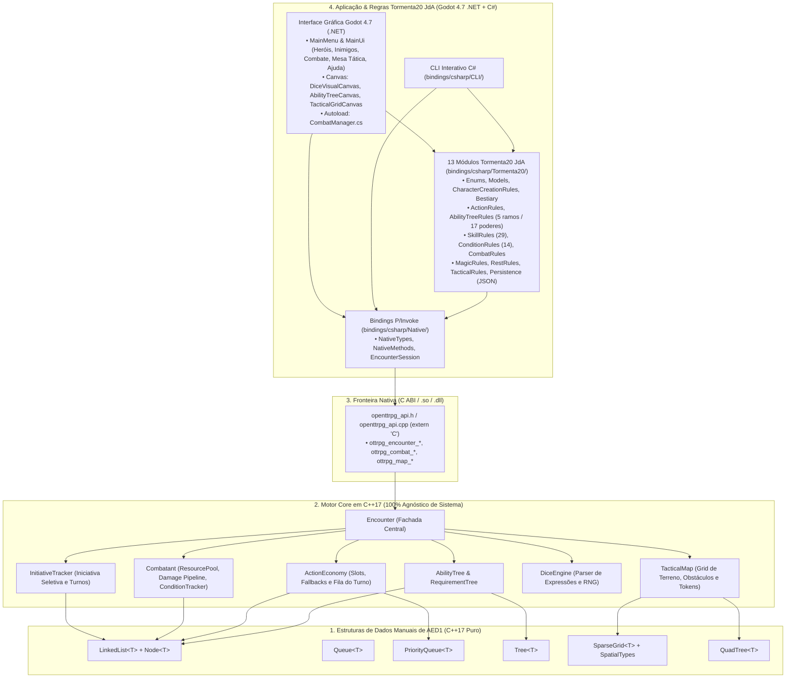

# OpenTTRPG

Projeto desenvolvido para a disciplina de **Algoritmos e Estruturas de Dados 1 (AED1) da UFSCar**. O **OpenTTRPG** é uma suíte completa de RPG de mesa (*Tabletop RPG*) estruturada em **4 camadas desacopladas**: **6 estruturas de dados manuais de AED1**, um **Core em C++17 100% agnóstico de sistema**, uma **camada modular de regras em C# (.NET 8)** para **Tormenta20 — Edição Jogo do Ano (T20 JdA)** e uma **Interface Gráfica multiplataforma em Godot Engine 4.7 (.NET)** com tabletop tático 2D integrado.

---

## Visão Geral e Arquitetura em 4 Camadas

O motor C++ (`libopenttrpg_core.so` / `openttrpg_core.dll`) não conhece nenhum nome de atributo, raça, classe, perícia ou regra de Tormenta20 — operando exclusivamente sobre identificadores numéricos genéricos (`EntityId`, `ResourceId`, `DamageTypeId`, `ActionTypeId`) e posições em grade (`GridPos`). Toda a modelagem de **Tormenta20 Jogo do Ano** vive modularizada em **13 arquivos C#**, consumidos tanto pela **UI em Godot 4.7** quanto pelo **CLI interativo**.



### 1. Estruturas de Dados Manuais de AED1 (`include/openttrpg/data_structures/`)
Implementadas do zero em C++17 com alocação dinâmica manual (`new`/`delete`), respeito à **Regra dos Cinco (*Rule of Five*)** e auditadas com **AddressSanitizer / LeakSanitizer (`make test_asan`)**:
* **`LinkedList<T>` (`Node<T>`):** Lista encadeada com acesso indexado e busca por predicado para combatentes, iniciativa, recursos e condições.
* **`Queue<T>`:** Fila dinâmica FIFO para processamento sequencial e rotacionamento de turnos.
* **`PriorityQueue<T>`:** Fila de prioridades ordenada estável (menor prioridade sai primeiro mantendo ordem de chegada) para ações planejadas no turno.
* **`Tree<T>` (`TreeNode<T>`):** Árvore N-ária genérica usada na concessão de habilidades e nas árvores lógicas de pré-requisitos.
* **`SparseGrid<T>` (`SpatialTypes.hpp`):** Matriz esparsa bidimensional com encadeamento ortogonal por linhas/colunas e mapa de posições para terreno, cobertura e bloqueio de visão do tabuleiro sem desperdício de memória em células vazias.
* **`QuadTree<T>`:** Particionamento espacial 2D recursivo para consultas de alcance, área e proximidade de tokens no mapa tático.

### 2. Motor Core em C++17 e C ABI (`include/openttrpg/core/`, `include/openttrpg/api/`)
* **`Encounter`, `InitiativeTracker` e `ActionEconomy`:** Combate por turnos com seleção explícita de participantes (`rollInitiativeForList`), desempates determinísticos, conversão direcional configurável e ações compostas.
* **`AbilityTree` e `RequirementTree`:** Validação hierárquica de ancestrais e avaliação lógica em pós-ordem (`AllOf`, `AnyOf`, `Not`, `AtLeastN`).
* **`Combatant`, `ResourcePool`, `Damage` e `ConditionTracker`:** Barras genéricas com absorção por recurso temporário e limites negativos, pipeline determinístico de dano (RD, vulnerabilidade, resistência, imunidade) e condições com duração por turno.
* **`DiceEngine` e `TacticalMap`:** Parser completo de dados (`"1d20+5"`, `"2d20kh1+4"`, `"4d6dl1"`, `"3d6!"`) e grid espacial agnóstico exposto via `ottrpg_map_*` na C ABI (`libopenttrpg_core.so` / `openttrpg_core.dll`).

### 3. Regras de Tormenta20 Jogo do Ano em C# (`bindings/csharp/Tormenta20/`)
Pacote modular de **13 arquivos** (`OpenTTRPG.Tormenta20`):
* **`Tormenta20Enums.cs` & `Tormenta20Models.cs`:** 14 Classes, 17 Raças, 34 Origens, 20 Deuses Maiores (+ Não Devoto), 14 Condições, 6 Atributos diretos; modelo unificado `CharacterSheetData` para Heróis e Ameaças/Inimigos (incluindo Estado de Morrendo `-max(10, PV_Max / 2)`, clones de combate e `AttackBonus`).
* **`Tormenta20CharacterCreationRules.cs`:** Cálculo automático de PV, PM, Defesa, deslocamento, perícias treinadas e equipamento inicial por Raça, Classe e Nível.
* **`Tormenta20Bestiary.cs`:** 8 ameaças canônicas de Tormenta20 JdA (de `Goblin Salteador` ND 1/4 a `Dragão Jovem` ND 7) com Defesa fixa, RD, bônus de ataque e overrides de perícias.
* **`Tormenta20ActionRules.cs` & `Tormenta20AbilityTreeRules.cs`:** Economia de ações (`Reação [5] -> Livre [10] -> Movimento [20] -> Padrão [30] -> Completa [40]`) com fallback `Padrão -> Movimento` e **5 ramos / 17 poderes** na árvore N-ária (`1. Esgrima (DES)`, `2. Brutalidade (FOR)`, `3. Bastião (CON)`, `4. Arcanismo (INT/CAR)`, `5. Arquearia (DES)`).
* **`Tormenta20SkillRules.cs` & `Tormenta20ConditionRules.cs`:** **29 perícias canônicas** com treino (`+2`/`+4`/`+6`) e penalidade de armadura/sobrecarga, além das **14 condições canônicas** com escalonamento (`Abalado -> Apavorado`) e teste de Morrendo/Sangramento (`CON CD 15`).
* **`Tormenta20CombatRules.cs`, `Tormenta20MagicRules.cs` & `Tormenta20RestRules.cs`:** Ataque vs Defesa, crítico exclusivo nos dados base, integração tática (flanqueamento/cobertura), aprimoramentos de magia com limite de PM por nível (`Magia Ilimitada`) e descanso (*Ruim*, *Normal*, *Confortável*, *Luxuoso*).
* **`Tormenta20TacticalRules.cs`:** Grid `1q = 1,5m`, diagonais `1-2-1-2`, pathfinding A\*/Dijkstra, Correr (`2x` Completa), Terreno Difícil (`2x`), Linha de Visão Supercover, Cobertura Leve (`+5 Defesa`), Flanqueamento (`+2 Ataque`), 4 presets de arena e `TacticalFogTracker`.
* **`Tormenta20Persistence.cs`:** Persistência JSON (`System.Text.Json`) para `saves/characters.json`, `saves/enemies.json` e `saves/encounter_snapshot.json` (incluindo clones de inimigos `InlineSheet` e mapa tático).

### 4. Interface Gráfica Godot 4.7 (.NET) (`godot_ui/open-ttrpg/`)
* **Ficha de Personagens (`MainUi.cs` / `MainUi.tscn`):** Partições redimensionáveis (`HSplitFicha` e `VSplitLeftCol`), criação automática por seletores (`OptionButton`), inventário por espaços, loja com `T$`, gasto direto de habilidades/magias com cálculo de PM, descanso e Estado de Morrendo.
* **Ficha Própria de Inimigos & Bestiário:** Aba dedicada para criar, editar e salvar ameaças em `saves/enemies.json` a partir dos 8 presets ou do zero.
* **Combate por Turnos + Bandeja de Dados Pop-up:** Lobby de iniciativa com múltipla seleção de heróis e clones de inimigos (`x1..x8`), barra de iniciativa, fila de prioridades de ações com desfazer e bandeja flutuante com animação procedural de dados poliedrais (`DiceVisualCanvas.cs`).
* **Árvore de Poderes & Tabletop Tático 2D:** Visualizador N-ário interativo (`AbilityTreeCanvas.cs`) e tabuleiro tático (`TacticalGridCanvas.cs`) com câmera suave (zoom interpolado no cursor + pan fluido), Névoa de Guerra, editor de terrenos/obstáculos e **aba Ajuda integrada** com guia rápido de comandos.

---

## Estrutura de Diretórios

```text
OpenTTRPG/
├── bindings/
│   └── csharp/                              # Camada C# (.NET 8 / Regras de T20 / P/Invoke)
│       ├── Native/                          # Interoperabilidade P/Invoke com a DLL / .so C++
│       │   ├── NativeTypes.cs
│       │   ├── NativeMethods.cs
│       │   └── EncounterSession.cs
│       ├── Tormenta20/                      # 13 módulos de regras de Tormenta20 Jogo do Ano
│       │   ├── Tormenta20Enums.cs
│       │   ├── Tormenta20Models.cs
│       │   ├── Tormenta20CharacterCreationRules.cs
│       │   ├── Tormenta20Bestiary.cs
│       │   ├── Tormenta20ActionRules.cs
│       │   ├── Tormenta20AbilityTreeRules.cs
│       │   ├── Tormenta20SkillRules.cs
│       │   ├── Tormenta20ConditionRules.cs
│       │   ├── Tormenta20CombatRules.cs
│       │   ├── Tormenta20MagicRules.cs
│       │   ├── Tormenta20RestRules.cs
│       │   ├── Tormenta20TacticalRules.cs
│       │   └── Tormenta20Persistence.cs
│       ├── CLI/                             # Interface de Linha de Comando (partial class)
│       │   ├── CLIController.cs
│       │   ├── CLIController.SheetMenu.cs
│       │   └── CLIController.CombatMenu.cs
│       ├── Tests/
│       │   └── Tormenta20Tests.cs           # 13 testes automatizados C# + P/Invoke
│       ├── OpenTTRPG.CLI.csproj
│       └── NuGet.Config
├── godot_ui/
│   └── open-ttrpg/                          # Projeto Godot Engine 4.7 (.NET)
│       ├── Cenas/
│       │   ├── MainMenu.tscn / MainMenu.cs
│       │   └── MainUi.tscn / MainUi.cs
│       ├── scripts/
│       │   ├── CombatManager.cs             # Autoload (ponte UI <-> C# <-> C++ + saves)
│       │   ├── DiceRoller.cs
│       │   ├── DiceVisualCanvas.cs          # Renderizador visual de dados poliedrais
│       │   ├── AbilityTreeCanvas.cs         # Grafo visual dos 5 ramos / 17 poderes
│       │   └── TacticalGridCanvas.cs        # Tabletop 2D com câmera suave e Névoa
│       ├── OpenTTRPG.csproj                 # Inclui PinOfflineNet8Packs (fallback offline)
│       └── export_presets.cfg               # Presets Linux x86_64 e Windows Desktop
├── docs/
│   ├── architecture.md                      # Engenharia das 4 camadas e diagramas
│   ├── tormenta20_rules.md                  # Regras de T20 JdA modeladas no sistema
│   ├── ui_integration_guide.md              # Arquitetura e fluxos da UI em Godot 4.7
│   ├── data_persistence_guide.md            # Esquema JSON e DTOs implementados
│   └── release_build_guide.md               # Build multiplataforma Linux/Windows e --self-test
├── include/openttrpg/
│   ├── api/openttrpg_api.h                  # C ABI estável (inclui ottrpg_map_*)
│   ├── core/                                # Motor C++17 agnóstico (Encounter, TacticalMap, etc.)
│   └── data_structures/                     # 6 estruturas AED1 (LinkedList, Queue, PriorityQueue, Tree, SparseGrid, QuadTree)
├── src/                                     # Implementações C++ (.cpp) exclusivas do Core e C ABI
├── tests/
│   ├── test_data_structures.cpp             # 7 suítes unitárias das 6 estruturas AED1
│   └── test_generic_core.cpp                # 11 suítes do Core Genérico, TacticalMap e C ABI
├── saves/
│   └── characters.json                      # Fichas iniciais (e enemies.json / encounter_snapshot.json em runtime)
├── build_windows.bat                        # Script de build e empacotamento nativo no Windows
├── CMakeLists.txt
├── Makefile
└── To_Do_List.md
```

---

## Como Compilar, Testar e Gerar Releases

### Pré-requisitos
* **Obrigatórios (Core C++):** `g++` com suporte a C++17 e `make`.
* **Camada C# (.NET 8 SDK):** `dotnet-sdk` (ex.: `sudo pacman -S dotnet-sdk` no Arch ou `sudo apt install dotnet-sdk-8.0` no Ubuntu/Debian).
* **Interface Gráfica e Exportação Multiplataforma:** Godot Engine 4 (.NET / `godot-mono` 4.7) e, para cross-compilar a DLL de Windows no Linux, `x86_64-w64-mingw32-g++` (`mingw-w64-gcc`).

### Comandos do `Makefile` e `build_windows.bat`

| Comando | O que faz |
| :--- | :--- |
| `make run-ui` | Compila `bin/libopenttrpg_core.so`, sincroniza para o projeto Godot e abre a **Interface Gráfica Godot 4.7**. |
| `make run` | Compila a biblioteca nativa C++ e executa o **CLI interativo** em C#. |
| `make test` | Roda toda a bateria automatizada: **7 suítes AED1** + **11 suítes Core/C ABI** + **13 testes C# Tormenta20**. |
| `make test_asan` | Recompila e executa os testes C++ com **AddressSanitizer + LeakSanitizer** garantindo **0 vazamentos de memória**. |
| `make test_csharp` | Executa somente os 13 testes automatizados em C# (`Tormenta20Tests`). |
| `make lib` | Compila apenas a biblioteca compartilhada `bin/libopenttrpg_core.so`. |
| `make release` | Gera a build portável **Linux x86_64** em `bin/release/linux-x64/`. |
| `make release-windows` | Cross-compila `openttrpg_core.dll` estática e empacota a build **Windows x64** em `bin/release/win-x64/`. |
| `make release-all` | Gera ambas as releases (**Linux + Windows**) e executa o diagnóstico **`--self-test` (8/8 etapas)** em modo headless. |
| `build_windows.bat` | Compila a DLL, publica a CLI, empacota `OpenTTRPG.exe` e executa `--self-test` diretamente no Windows. |
| `make clean` | Remove os diretórios `build/` e `bin/`. |

---

## Documentação Técnica

* **[Arquitetura e Engenharia de Software (`docs/architecture.md`)](docs/architecture.md):** Diagramas das 4 camadas, funcionamento das 6 estruturas manuais de AED1, Core C++ e UI Godot 4.7.
* **[Regras de Tormenta20 Jogo do Ano (`docs/tormenta20_rules.md`)](docs/tormenta20_rules.md):** Criação automática de ficha, Bestiário, Estado de Morrendo, 29 perícias, 14 condições, 5 ramos / 17 poderes, combate, magias, descanso e regras táticas em grade.
* **[Guia da Interface Gráfica — Godot 4.7 (.NET) (`docs/ui_integration_guide.md`)](docs/ui_integration_guide.md):** Arquitetura das cenas, atalhos do Tabletop, mapeamento completo `UI -> C# -> C ABI` e diretrizes visuais.
* **[Persistência de Dados JSON (`docs/data_persistence_guide.md`)](docs/data_persistence_guide.md):** Esquema implementado de `characters.json`, `enemies.json` e `encounter_snapshot.json` com mapa tático e clones.
* **[Guia de Build e Release Multiplataforma (`docs/release_build_guide.md`)](docs/release_build_guide.md):** Passo a passo para gerar releases Linux e Windows, fallback offline `.NET 8.0.32` e execução do `--self-test` (8/8).
* **[To-Do List e Roadmap (`To_Do_List.md`)](To_Do_List.md):** Histórico completo das 7 fases concluídas do projeto.
