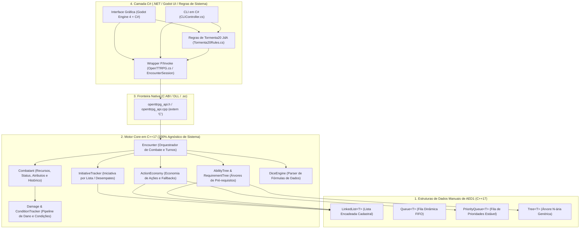

# OpenTTRPG

Projeto desenvolvido para a disciplina de **Algoritmos e Estruturas de Dados 1 (AED1) da UFSCar**. O objetivo é construir um motor modular e extensível de RPG de mesa (*Tabletop RPG*) estruturado sobre um **Core em C++17 100% agnóstico de sistema** e uma **camada de regras e aplicação em C# (.NET)** para **Tormenta20 — Edição Jogo do Ano (T20 JdA)** e futura interface gráfica em **Godot Engine 4**.

---

## Visão Geral e Como o Programa Está Estruturado

O projeto é dividido em **4 grandes camadas desacopladas** para garantir que o motor C++ possa rodar qualquer sistema de RPG (Tormenta20, D&D 5e, Pathfinder 2e, Ordem Paranormal, etc.), enquanto as regras específicas de sistema vivem na camada consumidora em **C#**:



### 1. Estruturas de Dados Manuais de AED1 (`include/openttrpg/data_structures/`)
Implementadas do zero em C++17 com alocação dinâmica de ponteiros (`new`/`delete`) e respeito estrito à **Regra dos Cinco (*Rule of Five*)**:
* **`LinkedList<T>` (`Node<T>`):** Lista encadeada dinâmica utilizada para armazenar combatentes, ordem de iniciativa, recursos, condições, estatísticas e listas cadastrais.
* **`Queue<T>`:** Fila dinâmica FIFO para processamento sequencial.
* **`PriorityQueue<T>`:** Fila de prioridades ordenada com preservação de ordem de chegada (FIFO) para elementos de mesma prioridade. Sustenta o agendamento e execução ordenada das ações do turno.
* **`Tree<T>` (`TreeNode<T>`):** Árvore N-ária genérica com ponteiros pai/filhos, busca por predicado, verificação de ancestralidade (`is_ancestor`), travessia em pré-ordem e pós-ordem. Sustenta todo o sistema de árvores de habilidades e pré-requisitos.

### 2. Motor Core em C++17 — 100% Agnóstico de Sistema (`include/openttrpg/core/` e `src/core/`)
Não pressupõe nenhum nome de atributo, tipo de ação ou regra de sistema específico:
* **`Encounter` e `InitiativeTracker`:** Gerencia combates por turnos onde **apenas os personagens selecionados (`rollInitiativeForList`) entram na iniciativa**; todas as ações (dano, cura, condições) operam por `EntityId` de alvo e nunca avançam o turno por acidente.
* **`ActionEconomy` (sobre `PriorityQueue<QueuedAction>`):** Permite que o sistema consumidor (em C#) defina quaisquer categorias de ação (`ActionTypeId`), suas prioridades de execução na fila e regras direcionais de conversão (`addFallback`).
* **`AbilityTree` e `RequirementTree` (sobre `Tree<T>`):** Avalia árvores de concessão de habilidades (exigindo que toda a cadeia ancestral na árvore já tenha sido aprendida) e árvores lógicas de pré-requisitos (`AllOf`, `AnyOf`, `Not`, `AtLeastN`) combinando atributos (`StatAtLeast`), habilidades (`AbilityUnlocked`), condições (`ConditionActive`), recursos (`ResourceAtLeast`) e ações já executadas no turno (`ActionUsedInTurn`).
* **`DiceEngine`:** Avaliador determinístico de expressões de dados (`"1d20+5"`, `"2d20kh1+4"`, `"4d6dl1"`, `"3d6!"`).
* **`ResourcePool`, `Damage` e `ConditionTracker`:** Barras de recursos genéricas (PV, PM, temporários), pipeline de cálculo de dano (RD, vulnerabilidade, resistência, imunidade) e condições com duração por turno.

### 3. Fronteira C ABI / Biblioteca Compartilhada (`include/openttrpg/api/openttrpg_api.h`)
Expõe todo o Core C++ através de funções C puras (`extern "C"`) compiladas em `bin/libopenttrpg_core.so` (Linux) ou `openttrpg_core.dll` (Windows), com tratamento seguro de erros via `ottrpg_last_error()`.

### 4. Camada de Sistema (Tormenta20 Jogo do Ano) e Aplicação em C# (`bindings/csharp/`)
Onde as regras específicas de **Tormenta20 JdA** são implementadas consumindo a DLL nativa via P/Invoke:
* **[`OpenTTRPG.cs`](bindings/csharp/OpenTTRPG.cs):** Wrapper gerenciado (`EncounterSession`) com métodos tipados prontos para uso na CLI e na interface gráfica (Godot).
* **[`Tormenta20Rules.cs`](bindings/csharp/Tormenta20Rules.cs):**
  * `Tormenta20ActionRules`: Define a economia de ações de T20 (`Ação Livre [Prioridade 10] -> Ação de Movimento [Prioridade 20] -> Ação Padrão [Prioridade 30]`) e a regra oficial em que uma **Ação Padrão pode ser gasta para pagar uma Ação de Movimento** (`addFallback`), mas o inverso é bloqueado.
  * `Tormenta20AbilityTreeRules`: Constrói a árvore de poderes de Tormenta20 (ex.: *Estilo de Uma Arma -> Ataque Preciso*, *Ataque Poderoso -> Trespassar*, *Encouraçado -> Inexpugnável -> Fanático*, *Magia Ilimitada -> Surto Arcano*) com pré-requisitos de aprendizado e de uso no turno.
* **[`CLIController.cs`](bindings/csharp/CLIController.cs):** Interface interativa de linha de comando em C# consumindo a biblioteca nativa.

---

## Estrutura de Diretórios

```text
OpenTTRPG/
├── bindings/
│   └── csharp/                         # Camada C# (.NET 10 / Regras de T20 / P/Invoke)
│       ├── OpenTTRPG.cs                # Wrapper C# (EncounterSession) sobre a DLL C++
│       ├── Tormenta20Rules.cs          # Regras de Ações e Árvore de Poderes de Tormenta20
│       ├── CLIController.cs            # Controlador do CLI em C#
│       ├── Program.cs                  # Ponto de entrada do executável C#
│       ├── OpenTTRPG.CLI.csproj        # Projeto .NET para execução via 'make run'
│       └── NuGet.Config                # Configuração offline para build sem dependência externa
├── docs/                               # Documentação técnica, regras e guia de UI
│   ├── architecture.md                 # Detalhamento da arquitetura e estruturas AED1
│   ├── ui_integration_guide.md         # Guia completo de quais funções puxar na Interface (Godot)
│   └── tormenta20_rules.md             # Especificação das regras canônicas de T20 JdA
├── include/
│   └── openttrpg/
│       ├── api/
│       │   └── openttrpg_api.h         # C ABI estável para exportação em DLL / .so
│       ├── core/                       # Motor C++17 100% agnóstico de sistema
│       │   ├── ActionEconomy.hpp       # Economia de ações de turno + PriorityQueue
│       │   ├── Combatant.hpp           # Entidade com recursos, atributos e habilidades
│       │   ├── Condition.hpp           # Rastreador de condições e durações
│       │   ├── Damage.hpp              # Pipeline de dano, RD e resistências
│       │   ├── Dice.hpp                # Motor e parser de expressões de dados
│       │   ├── Encounter.hpp           # Fachada central do encontro de combate
│       │   ├── InitiativeTracker.hpp   # Ordem de iniciativa e controle de rodadas
│       │   ├── RequirementTree.hpp     # Árvore de Habilidades e Pré-requisitos (sobre Tree<T>)
│       │   ├── Resource.hpp            # Barras de recursos com mínimo, máximo e temporário
│       │   └── Types.hpp               # Identificadores fundamentais do Core
│       ├── data_structures/            # Estruturas de dados manuais de AED1
│       │   ├── Node.hpp                # Nó encadeado simples
│       │   ├── LinkedList.hpp          # Lista encadeada cadastral (AED1)
│       │   ├── Queue.hpp               # Fila dinâmica FIFO (AED1)
│       │   ├── PriorityQueue.hpp       # Fila de prioridades ordenada estável (AED1)
│       │   └── Tree.hpp                # Árvore N-ária genérica (AED1)
│       ├── models/                     # Modelos legados em C++ (em migração para C#)
│       ├── systems/                    # Sistemas legados em C++ (em migração para C#)
│       └── cli/                        # CLI legado em C++
├── src/                                # Implementações em C++ (.cpp)
│   ├── api/
│   ├── core/
│   ├── models/
│   ├── systems/
│   ├── cli/
│   └── main.cpp
├── tests/
│   ├── test_data_structures.cpp        # Testes das estruturas lineares e modelos iniciais
│   └── test_generic_core.cpp           # Testes completos do Core Genérico, PriorityQueue, Tree e C API
├── To_Do_List.md                       # Roadmap atualizado e tarefas pendentes do projeto
├── Makefile                            # Automação de build, testes e execução (C++ e C#)
└── README.md                           # Documentação principal
```

---

## Como Compilar e Executar

### Pré-requisitos
1. **Obrigatórios (C++ Core):**
   * Compilador **`g++`** com suporte a **C++17**
   * **`make`**
2. **Para rodar a camada em C# (Recomendado):**
   * **.NET SDK** (`dotnet-sdk`, compatível com .NET 8 / 9 / 10)
   * Arch / Manjaro / CachyOS: `sudo pacman -S dotnet-sdk`
   * Ubuntu / Debian: `sudo apt install dotnet-sdk-8.0`

---

### Comandos do `Makefile`

O `Makefile` possui rastreamento automático de dependências de cabeçalhos (`-MMD -MP`), garantindo que qualquer alteração em arquivos `.hpp`, `.cpp` ou `.cs` seja recompilada automaticamente:

* **1. Executar o CLI Mais Atualizado (`make run`):**
  Compila a biblioteca compartilhada (`bin/libopenttrpg_core.so`) e o executável nativo, detecta automaticamente se o `.NET SDK` está instalado e inicia o CLI mais atualizado:
  ```bash
  make run
  ```
* **2. Forçar Execução em C# ou em C++:**
  ```bash
  make run-csharp   # Roda bindings/csharp/CLIController.cs consumindo bin/libopenttrpg_core.so
  make run-cpp      # Roda bin/openttrpg_cli diretamente em C++
  ```
* **3. Executar Todas as Baterias de Testes Automatizados:**
  Valida `LinkedList`, `Queue`, `PriorityQueue`, `Tree`, `ActionEconomy`, `AbilityTree`/`RequirementTree`, `Encounter` e a `C API (DLL)`:
  ```bash
  make test
  ```
* **4. Compilar Apenas a Biblioteca Nativa (`.so` / `.dll` para Godot):**
  ```bash
  make lib
  ```
* **5. Limpar Artefatos de Build:**
  ```bash
  make clean
  ```

---

## Documentação para Desenvolvedores e Equipe de Interface (Godot)

* **[Guia de Integração com a Interface Gráfica (Godot / C#)](docs/ui_integration_guide.md):** Explica passo a passo **quais funções C# puxar em cada tela e botão da interface** (como rolar dados na bandeja visual, selecionar quem entra na iniciativa, desenhar a fila de prioridades de ações e renderizar a árvore de habilidades com tooltips de pré-requisitos).
* **[Arquitetura e Engenharia de Software](docs/architecture.md):** Detalhes das estruturas de dados manuais de AED1 (`LinkedList`, `Queue`, `PriorityQueue`, `Tree`), gerenciamento de memória (RAII / Rule of Five) e especificação da C ABI.
* **[Regras de Tormenta20 (Jogo do Ano)](docs/tormenta20_rules.md):** Referência das regras canônicas de T20 JdA.
* **[To-Do List e Roadmap](To_Do_List.md):** Lista atualizada com o que já foi concluído e os próximos passos até a versão final.
