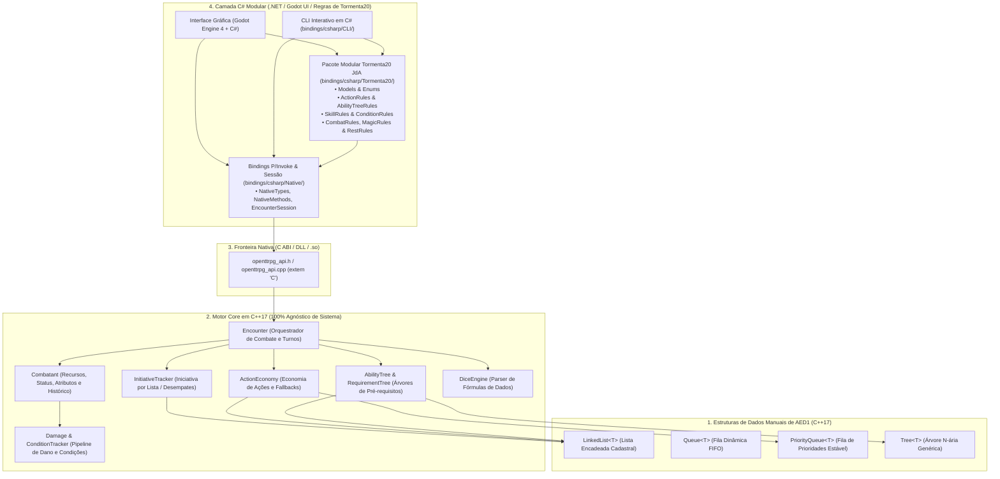

# OpenTTRPG

Projeto desenvolvido para a disciplina de **Algoritmos e Estruturas de Dados 1 (AED1) da UFSCar**. O objetivo é construir um motor modular e extensível de RPG de mesa (*Tabletop RPG*) estruturado sobre um **Core em C++17 100% agnóstico de sistema** e uma **camada modular de regras e aplicação em C# (.NET)** para **Tormenta20 — Edição Jogo do Ano (T20 JdA)**, pronta para integração com **Godot Engine 4**.

---

## Visão Geral e Como o Programa Está Estruturado

O projeto é dividido em **4 camadas estritamente desacopladas**. O motor C++ não conhece nenhum nome de atributo, perícia ou regra de Tormenta20 — permitindo que o mesmo binário nativo (`libopenttrpg_core.so` / `openttrpg_core.dll`) rode qualquer sistema de RPG (Tormenta20, D&D 5e, Pathfinder 2e, Ordem Paranormal, etc.), enquanto toda a modelagem de **Tormenta20 Jogo do Ano** vive organizada em módulos em **C#**:



### 1. Estruturas de Dados Manuais de AED1 (`include/openttrpg/data_structures/`)
Implementadas do zero em C++17 com alocação dinâmica de ponteiros (`new`/`delete`), respeito estrito à **Regra dos Cinco (*Rule of Five*)** e auditadas com **AddressSanitizer / LeakSanitizer (`make test_asan`)**:
* **`LinkedList<T>` (`Node<T>`):** Lista encadeada dinâmica utilizada para armazenar combatentes, ordem de iniciativa, recursos, condições, estatísticas e listas cadastrais.
* **`Queue<T>`:** Fila dinâmica FIFO para processamento sequencial.
* **`PriorityQueue<T>`:** Fila de prioridades ordenada com preservação de ordem de chegada (FIFO) para elementos de mesma prioridade. Sustenta o agendamento e execução ordenada das ações do turno.
* **`Tree<T>` (`TreeNode<T>`):** Árvore N-ária genérica com ponteiros pai/filhos, busca por predicado, verificação de ancestralidade (`is_ancestor`), travessia em pré-ordem e pós-ordem. Sustenta todo o sistema de árvores de habilidades e pré-requisitos.

### 2. Motor Core em C++17 — 100% Agnóstico de Sistema (`include/openttrpg/core/` e `src/core/`)
Não pressupõe nenhum nome de atributo, tipo de ação ou regra de sistema específico:
* **`Encounter` e `InitiativeTracker`:** Gerencia combates por turnos onde **apenas os personagens selecionados (`rollInitiativeForList`) entram na iniciativa**; todas as ações (dano, cura, condições) operam por `EntityId` de alvo e nunca avançam o turno por acidente.
* **`ActionEconomy` (sobre `PriorityQueue<QueuedAction>`):** Permite que o sistema consumidor (em C#) defina quaisquer categorias de ação (`ActionTypeId`), suas prioridades de execução na fila, custos compostos (`enqueueCompoundAction`) e regras direcionais de conversão (`addFallback`).
* **`AbilityTree` e `RequirementTree` (sobre `Tree<T>`):** Avalia árvores de concessão de habilidades (exigindo que toda a cadeia ancestral na árvore já tenha sido aprendida) e árvores lógicas de pré-requisitos (`AllOf`, `AnyOf`, `Not`, `AtLeastN`) combinando atributos (`StatAtLeast`), habilidades (`AbilityUnlocked`), condições (`ConditionActive`), recursos (`ResourceAtLeast`) e ações já executadas no turno (`ActionUsedInTurn`).
* **`DiceEngine`:** Avaliador determinístico de expressões de dados (`"1d20+5"`, `"2d20kh1+4"`, `"4d6dl1"`, `"3d6!"`).
* **`ResourcePool`, `Damage` e `ConditionTracker`:** Barras de recursos genéricas (PV, PM, temporários), pipeline de cálculo de dano (RD, vulnerabilidade, resistência, imunidade) e condições com políticas de acúmulo e duração por turno.

### 3. Fronteira C ABI / Biblioteca Compartilhada (`include/openttrpg/api/openttrpg_api.h`)
Expõe todo o Core C++ através de funções C puras (`extern "C"`) compiladas em `bin/libopenttrpg_core.so` (Linux) ou `openttrpg_core.dll` (Windows), com tratamento seguro de erros via `ottrpg_last_error()`.

### 4. Camada Modular de Regras (Tormenta20 Jogo do Ano) e Aplicação em C# (`bindings/csharp/`)
Toda a camada C# está organizada em 4 pacotes modulares:
* **`bindings/csharp/Native/` (`namespace OpenTTRPG.Native`):**
  * [`NativeTypes.cs`](bindings/csharp/Native/NativeTypes.cs), [`NativeMethods.cs`](bindings/csharp/Native/NativeMethods.cs) e [`EncounterSession.cs`](bindings/csharp/Native/EncounterSession.cs): Wrapper gerenciado `IDisposable` sobre a DLL C++.
* **`bindings/csharp/Tormenta20/` (`namespace OpenTTRPG.Tormenta20`):**
  * [`Tormenta20Enums.cs`](bindings/csharp/Tormenta20/Tormenta20Enums.cs) e [`Tormenta20Models.cs`](bindings/csharp/Tormenta20/Tormenta20Models.cs): Ficha completa (`CharacterSheetData`), atributos, inventário por espaços, sobrecarga, armas e magias.
  * [`Tormenta20ActionRules.cs`](bindings/csharp/Tormenta20/Tormenta20ActionRules.cs): Economia de ações (`Livre [10] -> Movimento [20] -> Padrão [30] -> Completa [40]`) e conversão unidirecional `Padrão -> Movimento`.
  * [`Tormenta20AbilityTreeRules.cs`](bindings/csharp/Tormenta20/Tormenta20AbilityTreeRules.cs): Árvores de poderes canônicos de Tormenta20 com validação de pré-requisitos de aprendizado e de uso no turno.
  * [`Tormenta20SkillRules.cs`](bindings/csharp/Tormenta20/Tormenta20SkillRules.cs): Catálogo das 30 perícias oficiais de T20 JdA ($\lfloor\text{Nível}/2\rfloor + \text{Atributo} + \text{Treino} + \text{Penalidade de Armadura}$).
  * [`Tormenta20ConditionRules.cs`](bindings/csharp/Tormenta20/Tormenta20ConditionRules.cs): Catálogo de 13 condições canônicas (*Abalado*, *Apavorado*, *Caído*, *Cego*, *Sangrando*, etc.), escalonamento automático (`Abalado` $\rightarrow$ `Apavorado`) e restrições de ação/atributos.
  * [`Tormenta20CombatRules.cs`](bindings/csharp/Tormenta20/Tormenta20CombatRules.cs): Resolução completa de ataque vs. Defesa, margem de ameaça (`19/x2`, `18/x3`), multiplicação exclusiva dos dados base da arma no crítico e integração com RD/vulnerabilidades.
  * [`Tormenta20MagicRules.cs`](bindings/csharp/Tormenta20/Tormenta20MagicRules.cs): Conjuração com aprimoramentos cumulativos e validação do limite de gasto de PM por nível (ou Nível + Atributo-chave com *Magia Ilimitada*).
  * [`Tormenta20RestRules.cs`](bindings/csharp/Tormenta20/Tormenta20RestRules.cs): Recuperação de PV e PM por qualidade de descanso (*Ruim*, *Normal*, *Confortável*, *Luxuoso*).
* **`bindings/csharp/CLI/` (`namespace OpenTTRPG.CLI`):**
  * [`CLIController.cs`](bindings/csharp/CLI/CLIController.cs), [`CLIController.SheetMenu.cs`](bindings/csharp/CLI/CLIController.SheetMenu.cs) e [`CLIController.CombatMenu.cs`](bindings/csharp/CLI/CLIController.CombatMenu.cs): Aplicação interativa de linha de comando dividida em `partial class`.
* **`bindings/csharp/Tests/` (`namespace OpenTTRPG.Tests`):**
  * [`Tormenta20Tests.cs`](bindings/csharp/Tests/Tormenta20Tests.cs): Bateria de testes automatizados em C# validando todas as regras de Tormenta20 e a integração P/Invoke.

---

## Estrutura de Diretórios

```text
OpenTTRPG/
├── bindings/
│   └── csharp/                              # Camada C# (.NET / Regras de T20 / P/Invoke)
│       ├── Native/                          # Camada de interoperabilidade P/Invoke com a DLL C++
│       │   ├── NativeTypes.cs               # Structs blittable e enums agnósticos da C ABI
│       │   ├── NativeMethods.cs             # Assinaturas [DllImport("openttrpg_core")]
│       │   └── EncounterSession.cs          # Wrapper gerenciado IDisposable + RequirementBuilder
│       ├── Tormenta20/                      # Pacote modular de regras de Tormenta20 Jogo do Ano
│       │   ├── Tormenta20Enums.cs           # Enums de T20 (Atributos, Tipos de Dano, Ações, Descanso)
│       │   ├── Tormenta20Models.cs          # Ficha (CharacterSheetData), Itens, Espaços, Magias
│       │   ├── Tormenta20ActionRules.cs     # Fila de prioridades de ações e conversão Padrão->Movimento
│       │   ├── Tormenta20AbilityTreeRules.cs# Árvores de poderes e pré-requisitos de T20
│       │   ├── Tormenta20SkillRules.cs      # Tabela de 30 perícias, treino (+2/+4/+6) e pen. armadura
│       │   ├── Tormenta20ConditionRules.cs  # 13 condições canônicas, escalonamento e sangramento
│       │   ├── Tormenta20CombatRules.cs     # Ataque vs. Defesa, críticos de dados base e RD
│       │   ├── Tormenta20MagicRules.cs      # Aprimoramentos e limite de gasto de PM por nível
│       │   └── Tormenta20RestRules.cs       # Descanso e recuperação de PV/PM entre encontros
│       ├── CLI/                             # Interface de Linha de Comando (partial class)
│       │   ├── CLIController.cs             # Menu principal, seed e rolador livre de dados
│       │   ├── CLIController.SheetMenu.cs   # Gerenciamento de fichas, inventário, perícias e poderes
│       │   └── CLIController.CombatMenu.cs  # Simulador de combate por turnos
│       ├── Tests/
│       │   └── Tormenta20Tests.cs           # Bateria de testes automatizados em C#
│       ├── OpenTTRPG.CLI.csproj             # Projeto .NET SDK
│       └── NuGet.Config                     # Configuração offline para build sem dependência externa
├── docs/                                    # Documentação técnica, regras e guias da equipe
│   ├── architecture.md                      # Detalhamento da arquitetura em 4 camadas e diagramas
│   ├── tormenta20_rules.md                  # Especificação das regras canônicas de T20 JdA no sistema
│   ├── ui_integration_guide.md              # Guia completo para a equipe de Interface (Godot 4 + C#)
│   └── data_persistence_guide.md            # Guia passo a passo para implementar a Persistência JSON
├── include/
│   └── openttrpg/
│       ├── api/
│       │   └── openttrpg_api.h              # C ABI estável para exportação em DLL / .so
│       ├── core/                            # Motor C++17 100% agnóstico de sistema
│       │   ├── ActionEconomy.hpp            # Economia de ações de turno + PriorityQueue
│       │   ├── Combatant.hpp                # Entidade com recursos, atributos e habilidades
│       │   ├── Condition.hpp                # Rastreador de condições e durações
│       │   ├── Damage.hpp                   # Pipeline de dano, RD e resistências
│       │   ├── Dice.hpp                     # Motor e parser de expressões de dados
│       │   ├── Encounter.hpp                # Fachada central do encontro de combate
│       │   ├── InitiativeTracker.hpp        # Ordem de iniciativa e controle de rodadas
│       │   ├── RequirementTree.hpp          # Árvore de Habilidades e Pré-requisitos (sobre Tree<T>)
│       │   ├── Resource.hpp                 # Barras de recursos com mínimo, máximo e temporário
│       │   └── Types.hpp                    # Identificadores fundamentais agnósticos do Core
│       └── data_structures/                 # Estruturas de dados manuais de AED1
│           ├── Node.hpp                     # Nó encadeado simples
│           ├── LinkedList.hpp               # Lista encadeada cadastral (AED1)
│           ├── Queue.hpp                    # Fila dinâmica FIFO (AED1)
│           ├── PriorityQueue.hpp            # Fila de prioridades ordenada estável (AED1)
│           └── Tree.hpp                     # Árvore N-ária genérica (AED1)
├── src/                                     # Implementações em C++ (.cpp) exclusivas do Core e C API
│   ├── api/
│   │   └── openttrpg_api.cpp
│   └── core/
├── tests/
│   ├── test_data_structures.cpp             # Testes unitários das 4 estruturas de dados manuais AED1
│   └── test_generic_core.cpp                # Testes completos do Core Genérico e da C API (DLL)
├── To_Do_List.md                            # Roadmap atualizado e tarefas do projeto
├── CMakeLists.txt                           # Configuração CMake para compilação multiplataforma da DLL
├── Makefile                                 # Automação de build, testes, ASan e execução (C++ e C#)
└── README.md                                # Documentação principal
```

---

## Como Compilar e Executar

### Pré-requisitos
1. **Obrigatórios (C++ Core):**
   * Compilador **`g++`** com suporte a **C++17**
   * **`make`**
2. **Camada de Regras e CLI em C#:**
   * **.NET SDK** (`dotnet-sdk`, compatível com .NET 8 / 9 / 10)
   * Arch / Manjaro / CachyOS: `sudo pacman -S dotnet-sdk`
   * Ubuntu / Debian: `sudo apt install dotnet-sdk-8.0`

---

### Comandos do `Makefile`

* **1. Executar o Programa Interativo (`make run`):**
  Compila a biblioteca compartilhada (`bin/libopenttrpg_core.so`) e inicia a aplicação C# consumindo o Core nativo via P/Invoke:
  ```bash
  make run
  ```
* **2. Executar Todas as Baterias de Testes Automatizados (C++ AED1 + C++ Core/DLL + C# Tormenta20):**
  ```bash
  make test
  ```
* **3. Executar Auditoria de Memória com AddressSanitizer & LeakSanitizer (`make test_asan`):**
  Verifica que as 4 estruturas manuais de AED1 (`LinkedList`, `Queue`, `PriorityQueue`, `Tree`) e o Core C++ possuem zero vazamentos de memória (*memory leaks*) ou acessos inválidos:
  ```bash
  make test_asan
  ```
* **4. Executar Apenas a Suíte de Testes de C# (`make test_csharp`):**
  ```bash
  make test_csharp
  ```
* **5. Compilar Apenas a Biblioteca Nativa (`.so` / `.dll` para Godot):**
  ```bash
  make lib
  ```
* **6. Limpar Artefatos de Build:**
  ```bash
  make clean
  ```

---

## Documentação Técnica e Guias da Equipe

* **[Arquitetura e Engenharia de Software (`docs/architecture.md`)](docs/architecture.md):** Representação visual detalhada das 4 camadas, funcionamento interno das estruturas de dados manuais de AED1 (`LinkedList`, `Queue`, `PriorityQueue`, `Tree`), fluxos do Core C++ e integração com os módulos de Tormenta20 em C#.
* **[Guia de Implementação da Persistência de Dados JSON (`docs/data_persistence_guide.md`)](docs/data_persistence_guide.md):** Instruções passo a passo e código de referência para quem for implementar o salvamento e carregamento de fichas e combates em JSON (`System.Text.Json`).
* **[Guia de Integração com a Interface Gráfica — Godot Engine 4 (`docs/ui_integration_guide.md`)](docs/ui_integration_guide.md):** Mapa completo de quais classes e funções C# chamar em cada tela e botão do Godot.
* **[Regras de Tormenta20 Jogo do Ano (`docs/tormenta20_rules.md`)](docs/tormenta20_rules.md):** Especificação das fórmulas e subsistemas canônicos de T20 JdA implementados no projeto.
* **[To-Do List e Roadmap (`To_Do_List.md`)](To_Do_List.md):** Status atualizado das etapas concluídas e próximas fases.
