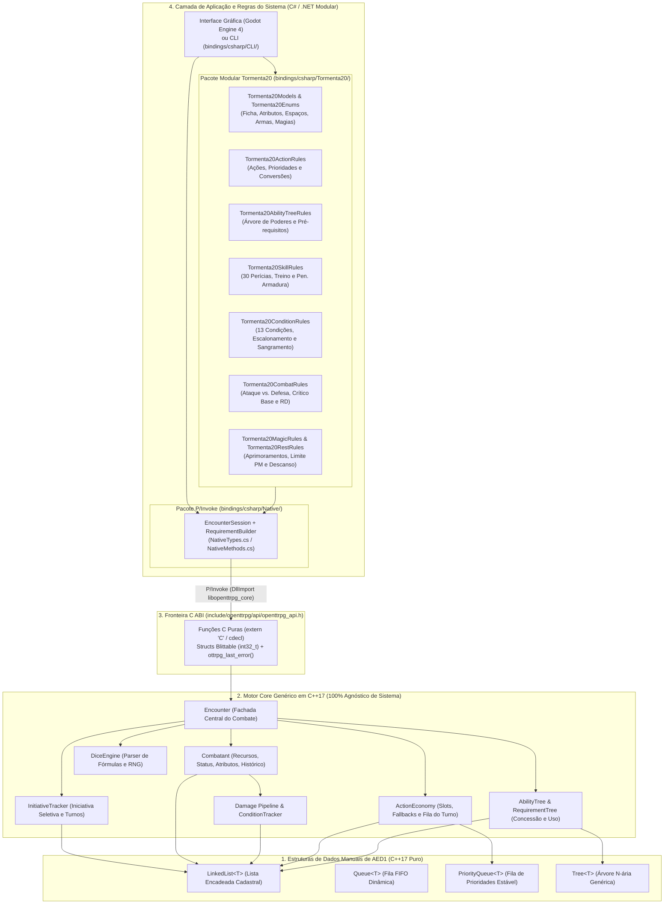
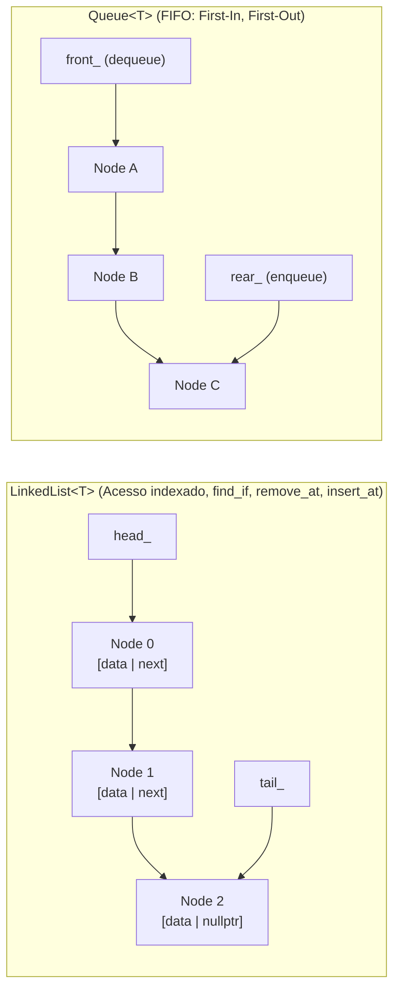
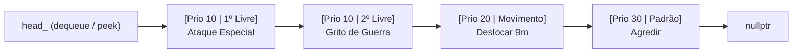
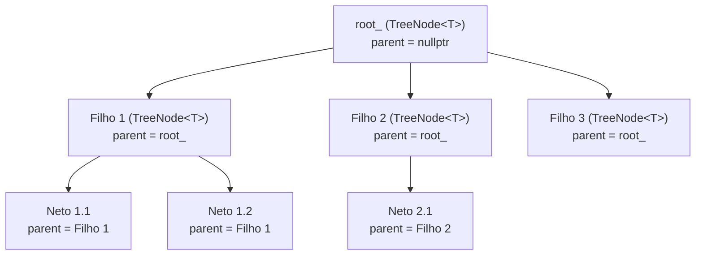
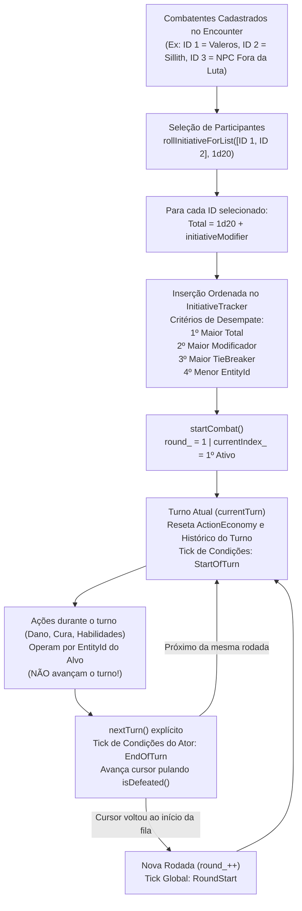
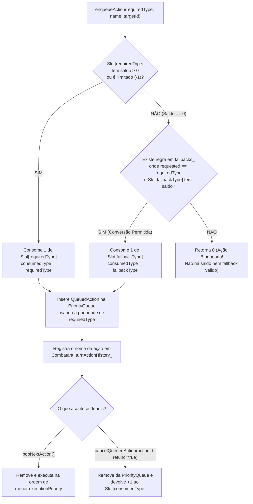
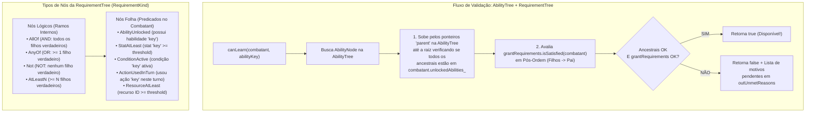
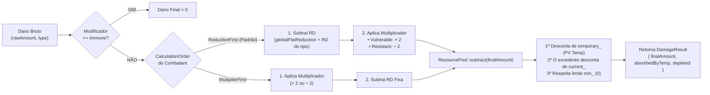
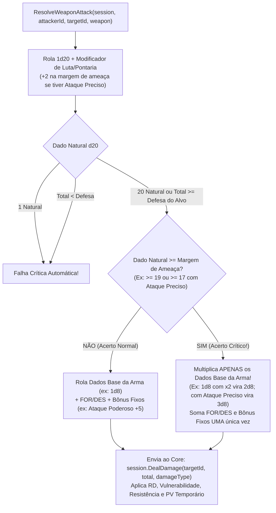

# Arquitetura e Representação Visual do Sistema — OpenTTRPG

Este documento apresenta a engenharia de software e a **representação visual detalhada** de cada subsistema do **Core Genérico em C++17**, das **Estruturas de Dados Manuais de AED1**, da **Fronteira C ABI** e do **Pacote Modular de Regras de Tormenta20 (Jogo do Ano) em C#**.

---

## 1. Visão Macro: Arquitetura em 4 Camadas e Fronteira Nativa (P/Invoke)

O **OpenTTRPG** separa estritamente **mecanismos universais de RPG** (em C++17) de **regras específicas de um sistema** (em C#). Nenhum arquivo C++ conhece o que é "Tormenta20", "Pontos de Mana", "Luta" ou "Ataque Poderoso" — tudo no C++ opera sobre identificadores genéricos (`EntityId`, `ResourceId`, `DamageTypeId`, `ActionTypeId`) e árvores/filas abstratas:

---

## 2. Representação Visual das Estruturas de Dados de AED1 (`include/openttrpg/data_structures/`)

Todas as 4 estruturas foram implementadas manualmente do zero com ponteiros (`new` / `delete`), obedecem à **Regra dos Cinco (*Rule of Five*)** (destrutor virtual/explícito, construtor de cópia, operador de atribuição por cópia, construtor de movimento e atribuição por movimento) e são verificadas contra vazamentos de memória via `make test_asan` (`-fsanitize=address,leak`).

### 2.1. `LinkedList<T>` e `Queue<T>`

### 2.2. `PriorityQueue<T>` (Fila de Prioridades Ordenada Estável)
Elementos com **menor valor numérico de `priority`** saem primeiro na frente da fila. Em caso de **empate de prioridade**, preserva-se a ordem exata de chegada (**estabilidade FIFO**):

* **Inserção (`enqueue(value, priority)`)**: Percorre a lista enquanto `curr->priority <= priority` e insere o novo nó logo após o último elemento de mesma prioridade ($O(N)$), garantindo estabilidade sem reordenar elementos antigos.
* **Remoção seletiva (`remove_if`)**: Permite cancelar uma ação específica no meio da fila (usado quando o jogador desfaz uma ação agendada no turno e recebe o slot de volta).

### 2.3. `Tree<T>` (Árvore N-ária Genérica)
Cada `TreeNode<T>` possui um ponteiro para seu `parent` (permitindo subir até a raiz em $O(h)$ para validar ancestralidade) e uma `LinkedList<TreeNode<T>*> children` (permitindo um número ilimitado de filhos por nó):

---

## 3. Como Cada Subsistema do Core C++ Funciona

### 3.1. `InitiativeTracker` & `Encounter` — Seleção de Participantes e Ciclo de Turnos
No Core, **cadastrar um combatente não o força a entrar na lista de iniciativa**. O método `rollInitiativeForList` recebe apenas os IDs escolhidos para participar daquele combate, rola a iniciativa e insere cada um na posição ordenada correta:

---

### 3.2. `ActionEconomy` — Slots de Ação, Conversão Direcional (`Fallback`), Custos Compostos e Fila de Prioridades
O `ActionEconomy` é **100% agnóstico de sistema**: ele gerencia uma lista de `ActionSlot`s, uma lista de regras direcionais `ActionFallbackRule` (`requestedType -> fallbackType`) e uma `PriorityQueue<QueuedAction>`:

* **Ações Compostas (`enqueueCompoundAction`)**: Usadas para ações que exigem múltiplos slots simultaneamente (como a **Ação Completa** em Tormenta20, que consome `1 Ação Padrão + 1 Ação de Movimento`). Se o jogador cancelar a ação composta na fila, todos os slots consumidos são reembolsados atomicamente.

---

### 3.3. `AbilityTree` & `RequirementTree` — Árvore de Habilidades + Árvore Lógica de Pré-requisitos
Este subsistema combina **duas árvores (`Tree<T>`) trabalhando em conjunto**:

1. **`AbilityTree` (`Tree<AbilityNode>`)**: Modela a hierarquia entre habilidades (qual poder é filho de qual poder).
2. **`RequirementTree` (`Tree<RequirementNode>`)**: Dentro de cada `AbilityNode`, existem **duas** árvores de expressão lógica avaliadas em **pós-ordem** (filhos avaliados antes do pai):
   - **`grantRequirements`**: Avaliada em `canLearn()` / `learn()` para saber se o personagem pode **adquirir/desbloquear** a habilidade.
   - **`usageRequirements`**: Avaliada em `canUse()` durante o combate para saber se o personagem pode **ativar** a habilidade naquele momento do turno.

---

### 3.4. `ResourcePool`, Pipeline de `Damage` e `ConditionTracker`

#### Pipeline de Dano e Absorção por Recurso Temporário (`Damage.cpp` + `Resource.cpp`)
Quando `Encounter::dealDamage(targetId, rawAmount, damageType)` é chamado, o dano passa por um pipeline determinístico antes de tocar nos pontos de vida:

---

## 4. Como os Módulos de Tormenta20 em C# Funcionam (`bindings/csharp/Tormenta20/`)

Toda a lógica específica de **Tormenta20 — Edição Jogo do Ano** está dividida em 9 arquivos modulares dentro de `bindings/csharp/Tormenta20/` (`namespace OpenTTRPG.Tormenta20`):

### 4.1. `Tormenta20ActionRules.cs` — Economia de Ações e Fila de Prioridades
* Registra os slots de ação no Core:
  - `Free` (`ID 0`, Prioridade `10`, Ilimitada `-1`)
  - `Movement` (`ID 1`, Prioridade `20`, `1` por turno)
  - `Standard` (`ID 2`, Prioridade `30`, `1` por turno)
  - `Full` (`ID 3`, Prioridade `40`, consome `Standard + Movement` via `EnqueueCompoundAction`)
  - `Reaction` (`ID 4`, Prioridade `5`, Ilimitada `-1`)
* Registra a regra oficial `AddActionFallback(Movement, Standard)`: permite gastar a **Ação Padrão** para realizar uma **Ação de Movimento** adicional, mas bloqueia o inverso.
* Antes de enfileirar qualquer ação, consulta `Tormenta20ConditionRules.CanExecuteActionType(...)` para verificar se o combatente está sob condições restritivas (ex.: *Imóvel* ou *Lento* bloqueiam Ações Completas; *Enjoado* permite apenas 1 Ação Padrão **ou** 1 de Movimento por turno).

### 4.2. `Tormenta20AbilityTreeRules.cs` — Árvore de Poderes Canônicos
Constrói os 4 ramos na `AbilityTree` do Core:
1. **Estilo de Uma Arma** (`DES >= 1`) $\rightarrow$ **Ataque Preciso**
2. **Ataque Poderoso** (`FOR >= 1`) $\rightarrow$ **Trespassar** (exige ter executado `"Agredir (Ataque Padrão)"` no turno atual)
3. **Encouraçado** (`CON >= 1`) $\rightarrow$ **Inexpugnável** (`Nivel >= 6`) $\rightarrow$ **Fanático** (`Nivel >= 12`)
4. **Magia Ilimitada** (`INT >= 1 OU CAR >= 1`) $\rightarrow$ **Surto Arcano** (exige condição `Foco_Arcano` ativa **ou** ter lançado `"Mísseis Mágicos"` no turno)

### 4.3. `Tormenta20SkillRules.cs` — Sistema Completo de Perícias
Implementa a tabela oficial de 30 perícias de Tormenta20 Jogo do Ano:
$$\text{Total da Perícia} = \left\lfloor \frac{\text{Nível}}{2} \right\rfloor + \text{AtributoEfetivo} + \text{BônusDeTreino} + \text{PenalidadeDeArmadura} + \text{PenalidadeDeCondição} + \text{Outros}$$
* **Bônus de Treinamento por Patamar:** `+2` (Níveis 1 a 6), `+4` (Níveis 7 a 14) e `+6` (Níveis 15 a 20).
* **Somente Treinada (`TrainedOnly`):** Bloqueia testes de perícias como *Ladinagem*, *Misticismo*, *Cura* e *Ofício* se o personagem não for treinado.
* **Penalidade de Armadura (`ArmorPenaltyApplies`):** Aplica automaticamente a penalidade de armaduras/escudos equipados (e `–5` adicional se estiver **Sobrecarregado**) em *Acrobacia*, *Furtividade* e *Ladinagem*.

### 4.4. `Tormenta20CombatRules.cs` — Resolução de Ataques vs. Defesa e Multiplicação Crítica

### 4.5. `Tormenta20ConditionRules.cs` — Catálogo de 13 Condições Canônicas
Gerencia os efeitos mecânicos automáticos de condições no combate:
* **Escalonamento de Medo:** Aplicar **Abalado** em quem já está **Abalado** converte automaticamente a condição para **Apavorado**.
* **Modificadores de Defesa e Atributos:** *Caído* (`–5` Defesa e ataque corpo a corpo), *Desprevenido* (`–5` Defesa e Reflexos), *Vulnerável* (`–2` Defesa), *Cego* (`–5` Defesa e `–2` em FOR/DES), *Fraco* (`–2` em FOR/DES/CON).
* **Sangramento:** No início do turno (`ProcessStartOfTurnBleeding`), rola um teste de Constituição (`1d20 + CON >= CD 15`). Se passar, estanca o sangramento; se falhar, perde `1d6` PV.

### 4.6. `Tormenta20MagicRules.cs` & `Tormenta20RestRules.cs` — Magias e Descanso
* **Limite de PM (`Tormenta20MagicRules`):** Em Tormenta20, o máximo de PM que um personagem pode gastar em uma única magia ou habilidade com aprimoramentos é igual ao seu **Nível**. Se o personagem possuir o poder **Magia Ilimitada**, esse limite passa a ser $\text{Nível} + \text{Atributo-Chave}$.
* **Recuperação de Descanso (`Tormenta20RestRules`):** Calcula e aplica a recuperação de PV e PM por noite de descanso:
  - *Ruim*: $\max(1, \lfloor \text{Nível} / 2 \rfloor)$
  - *Normal*: $1 \times \text{Nível}$
  - *Confortável*: $2 \times \text{Nível}$
  - *Luxuoso*: $3 \times \text{Nível}$

---

## 5. Documentos Relacionados

* **[Guia de Implementação da Persistência de Dados JSON (`docs/data_persistence_guide.md`)](data_persistence_guide.md):** Instruções detalhadas e código de referência para salvar/carregar fichas e snapshots de combate em JSON.
* **[Guia de Integração com a Interface Gráfica (`docs/ui_integration_guide.md`)](ui_integration_guide.md):** Mostra exatamente quais métodos de `EncounterSession` e dos módulos `Tormenta20*Rules` chamar em cada botão e tela do Godot Engine 4 + C#.
* **[Regras de Tormenta20 (`docs/tormenta20_rules.md`)](tormenta20_rules.md):** Referência das fórmulas e tabelas oficiais de Tormenta20 Jogo do Ano.
* **[To-Do List (`To_Do_List.md`)](../To_Do_List.md):** Roadmap atualizado do projeto.
