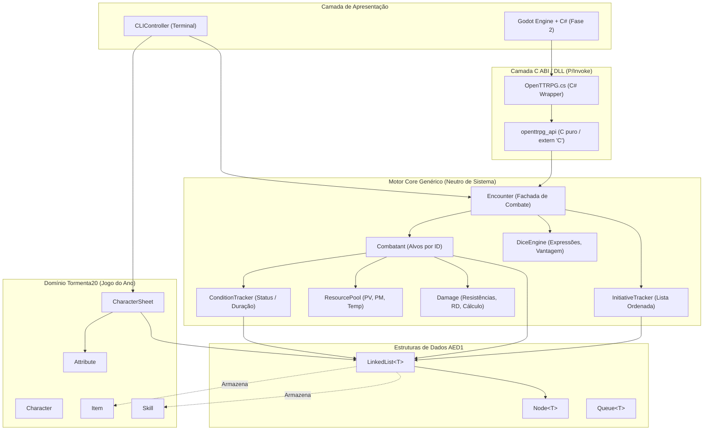

# Arquitetura e Engenharia de Software — OpenTTRPG

Projeto desenvolvido no contexto acadêmico de **Algoritmos e Estruturas de Dados 1 (AED1 - UFSCar)**, implementando as regras oficiais de **Tormenta20 — Edição Jogo do Ano (T20 JdA)**.

---

## 1. Visão Geral do Sistema

O projeto adota uma arquitetura em camadas desacoplada em **C++17 puro**:

1. **Camada de Estruturas de Dados Manuais (AED1):**
   Implementações manuais (`Node<T>`, `LinkedList<T>`, `Queue<T>`) com alocação dinâmica e respeito estrito à Regra dos Cinco (*Rule of Five*), sem uso de containers da STL nas estruturas avaliadas.
2. **Camada Core Genérica (Motor Neutro de Regras / DLL para C#):**
   Mecanismos universais de RPG que funcionam sem sistema pré-definido:
   * **Iniciativa Ordenada & Turnos (`InitiativeTracker`):** Inserção/remoção dinâmica no meio do combate, desempates automáticos, reordenação de ações sem perda de turnos ou erro de contagem de rodadas.
   * **Gerenciamento de Recursos (`ResourcePool`):** Barras com valores mín/máx/temporário para Vida, Mana, Estamina, Sanidade, etc., com absorção automática de dano por recurso temporário.
   * **Pipeline de Dano e Defesas (`Damage`):** Tipos numéricos de dano, fraquezas/resistências/imunidades configuráveis, RD fixa (global ou por tipo) e ordens de aplicação flexíveis.
   * **Condições e Efeitos (`ConditionTracker`):** Rastreamento de status com controle de acúmulo, intensidade e duração decrescente com base em gatilhos de turno e rodada.
   * **Entidade Genérica (`Combatant`):** Combatente com recursos arbitrários, perfil de dano e vínculo de time.
   * **Fachada de Combate (`Encounter`):** Orquestrador do encontro onde **todas as ações são direcionadas por ID de alvo** (resolvendo o problema de dano cair no primeiro da fila).
   * **Motor de Dados (`DiceEngine`):** Avaliação determinística com suporte a expressões ("2d20kh1+5", "4d6dl1", dados explosivos "3d6!") e sementes fixas para replays/multiplayer.
3. **Camada C ABI & Interop para C# (`openttrpg_api`):**
   Interface estritamente em linguagem C com convenção `cdecl`, structs blittable (apenas `int32_t`), isolamento completo de exceções C++ via `ottrpg_last_error()` e buffers seguros gerenciados pelo chamador. Permite compilação como `.so` / `.dll` e carregamento direto via P/Invoke (`bindings/csharp/OpenTTRPG.cs`).
4. **Camada de Domínio Tormenta20 (Regras Oficiais):**
   Modelos que implementam fichas, atributos, inventário com regras de espaços e economia de Arton (T$).
5. **Camada de Apresentação:**
   CLI interativo via terminal (Fase 1) e integração com Godot Engine + C# (Fase 2).



---

## 2. Estrutura de Diretórios

```text
OpenTTRPG/
├── bindings/                           # Bindings para outras linguagens (Fase 2)
│   └── csharp/
│       └── OpenTTRPG.cs                # P/Invoke + Wrapper C# para Godot
├── docs/                               # Documentação técnica e de regras
│   ├── architecture.md                 # Arquitetura e padrões do sistema
│   └── tormenta20_rules.md             # Regras canônicas de Tormenta20 Jogo do Ano
├── include/                            # Cabeçalhos (.hpp e .h)
│   └── openttrpg/
│       ├── api/                        # ABI C estável para DLL/.so
│       │   └── openttrpg_api.h
│       ├── core/                       # Motor Genérico e Tipos Básicos
│       │   ├── Combatant.hpp           # Combatente genérico por ID
│       │   ├── Condition.hpp           # Efeitos e condições com duração
│       │   ├── Damage.hpp              # Pipeline e cálculo de dano/resistências
│       │   ├── Dice.hpp                # Motor determinístico de dados e expressões
│       │   ├── Encounter.hpp           # Fachada de combate por turnos
│       │   ├── InitiativeTracker.hpp   # Rastreador ordenado de iniciativa
│       │   ├── Resource.hpp            # Barras com mín/máx/temporário
│       │   └── Types.hpp               # Tipos e enums fundamentais
│       ├── data_structures/            # Estruturas manuais com alocação dinâmica (AED1)
│       │   ├── Node.hpp                # Nó encadeado genérico
│       │   ├── LinkedList.hpp          # Lista Simplesmente Encadeada (AED1)
│       │   └── Queue.hpp               # Fila FIFO (AED1)
│       ├── models/                     # Entidades do RPG Tormenta20
│       ├── systems/                    # Mecânicas legadas do CLI de T20
│       └── cli/
│           └── CLIController.hpp       # Controlador da interface do terminal
├── src/                                # Implementações em C++ (.cpp)
│   ├── api/
│   │   └── openttrpg_api.cpp           # Implementação das funções C da DLL
│   ├── core/                           # Implementação do motor genérico
│   │   ├── Combatant.cpp
│   │   ├── Condition.cpp
│   │   ├── Damage.cpp
│   │   ├── Dice.cpp
│   │   ├── Encounter.cpp
│   │   ├── InitiativeTracker.cpp
│   │   └── Resource.cpp
│   ├── models/
│   ├── systems/
│   ├── cli/
│   └── main.cpp                        # Ponto de entrada CLI
├── tests/
│   ├── test_data_structures.cpp        # Bateria de testes de estruturas e T20 (AED1)
│   └── test_generic_core.cpp           # Bateria de testes do Core Genérico e C API (DLL)
├── Makefile                            # Build script: all, lib, test, run, clean
├── CMakeLists.txt                      # Script modular para CMake
└── README.md
```

---

## 3. Gerenciamento de Memória (RAII e Princípios de AED1)

As estruturas lineares em `include/openttrpg/data_structures/`:
* Utilizam operadores `new` e `delete` para manipulação de nós dinâmicos (`Node<T>`).
* Respeitam a **Regra dos Cinco (Rule of Five)** em C++:
  * Destrutor que percorre e desaloca todos os nós (`clear()`), prevenindo *memory leaks*.
  * Construtor de cópia profunda (*deep copy*) para clonagem segura de listas e filas.
  * Operador de atribuição por cópia (*copy assignment*).
  * Construtor de movimento (*move constructor*) com transferência de ponteiros `noexcept`.
  * Operador de atribuição por movimento (*move assignment*).

---

## 4. Como Compilar e Executar

### Pré-requisitos
* Compilador C++ com suporte a **C++17** (`g++` versão 9 ou superior).
* Utilitário `make` ou `cmake` (3.15+).

### Comandos de Terminal

* **Compilar Tudo (Executável CLI + Biblioteca Compartilhada `.so`/`.dll`):**
  ```bash
  make all
  ```
* **Compilar apenas a Biblioteca Compartilhada (DLL):**
  ```bash
  make lib
  ```
* **Executar Ambas as Baterias de Testes Automatizados:**
  ```bash
  make test
  ```
* **Executar o Programa CLI no Terminal:**
  ```bash
  make run
  ```
* **Limpar os Artefatos de Compilação (`build/` e `bin/`):**
  ```bash
  make clean
  ```

