# Arquitetura e Representação Visual do Sistema — OpenTTRPG

Este documento apresenta a engenharia de software e a **representação visual detalhada** de cada subsistema do **Core Genérico em C++17**, das **Estruturas de Dados Manuais de AED1** e do **Pacote de Regras de Tormenta20 (Jogo do Ano) em C#**.

---

## 1. Visão Macro: Arquitetura em 4 Camadas e Fronteira Nativa (P/Invoke)

O **OpenTTRPG** separa estritamente **mecanismos universais de RPG** (em C++17) de **regras específicas de um sistema** (em C#):

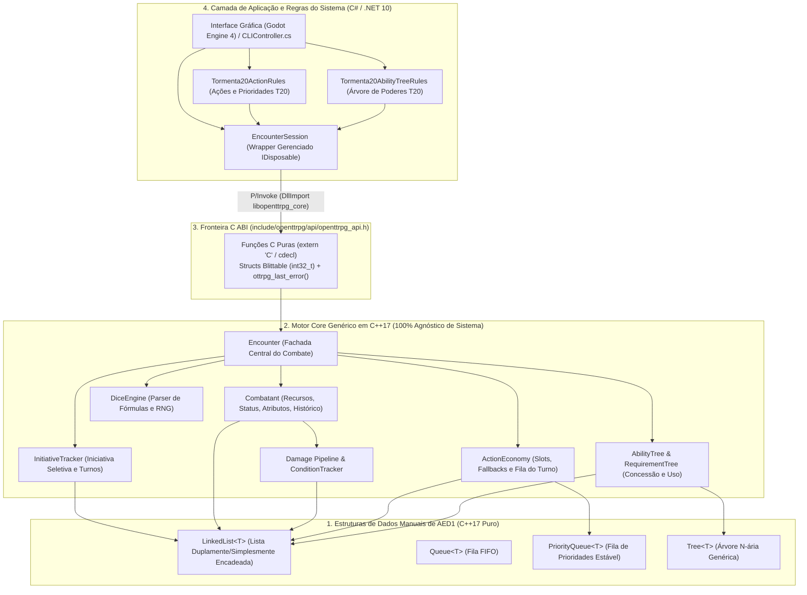

---

## 2. Representação Visual das Estruturas de Dados de AED1 (`include/openttrpg/data_structures/`)

Todas as 4 estruturas foram implementadas manualmente do zero com ponteiros (`new` / `delete`) e obedecem à **Regra dos Cinco (*Rule of Five*)**.

### 2.1. `LinkedList<T>` e `Queue<T>`
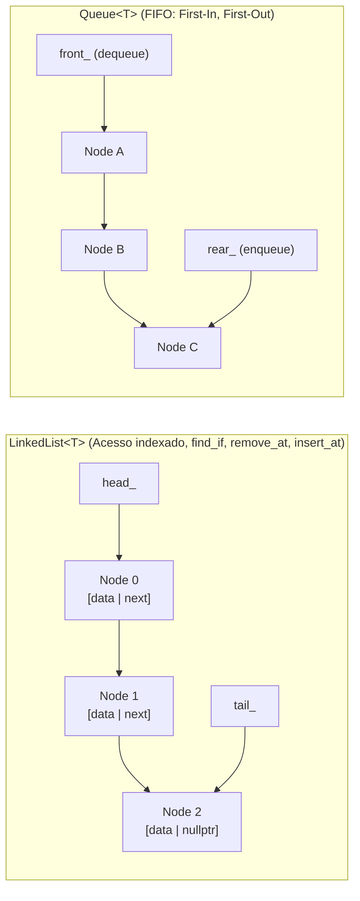

### 2.2. `PriorityQueue<T>` (Fila de Prioridades Ordenada Estável)
Elementos com **menor valor numérico de `priority`** saem primeiro na frente da fila. Em caso de **empate de prioridade**, preserva-se a ordem exata de chegada (**estabilidade FIFO**):

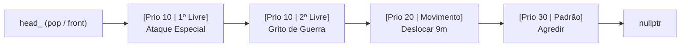
* **Inserção (`push(value, priority)`)**: Percorre a lista enquanto `curr->priority <= priority` e insere o novo nó logo após o último elemento de mesma prioridade ($O(N)$), garantindo estabilidade sem reordenar elementos antigos.
* **Remoção seletiva (`remove_if`)**: Permite cancelar uma ação específica no meio da fila (usado quando o jogador desfaz uma ação agendada no turno).

### 2.3. `Tree<T>` (Árvore N-ária Genérica)
Cada `TreeNode<T>` possui um ponteiro para seu `parent` (permitindo subir até a raiz em $O(h)$ para validar ancestralidade) e uma `LinkedList<TreeNode<T>*> children` (permitindo um número ilimitado de filhos por nó):

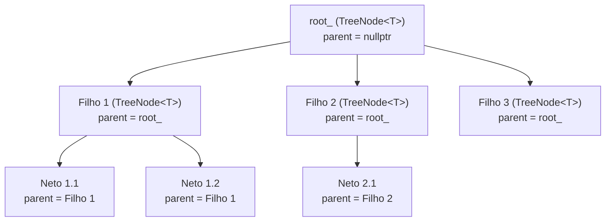

---

## 3. Como Cada Parte do Core C++ Funciona (Representação Visual Detalhada)

### 3.1. `InitiativeTracker` & `Encounter` — Seleção de Participantes e Ciclo de Turnos
No Core, **cadastrar um combatente não o força a entrar na lista de iniciativa**. O método `rollInitiativeForList` recebe apenas os IDs escolhidos para participar daquele combate, rola a iniciativa e insere cada um na posição ordenada correta:

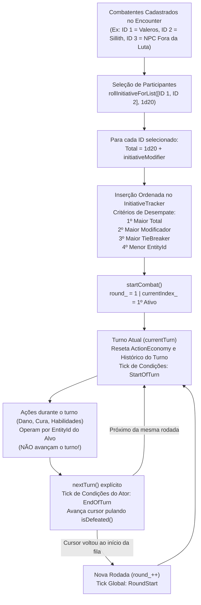

---

### 3.2. `ActionEconomy` — Slots de Ação, Conversão Direcional (`Fallback`) e Fila de Prioridades
O `ActionEconomy` é **100% agnóstico de sistema**: ele não sabe o que é "Ação Padrão" ou "Ação de Movimento". Ele gerencia uma lista de `ActionSlot`s, uma lista de regras direcionais `ActionFallbackRule` (`requestedType -> fallbackType`) e uma `PriorityQueue<QueuedAction>`:

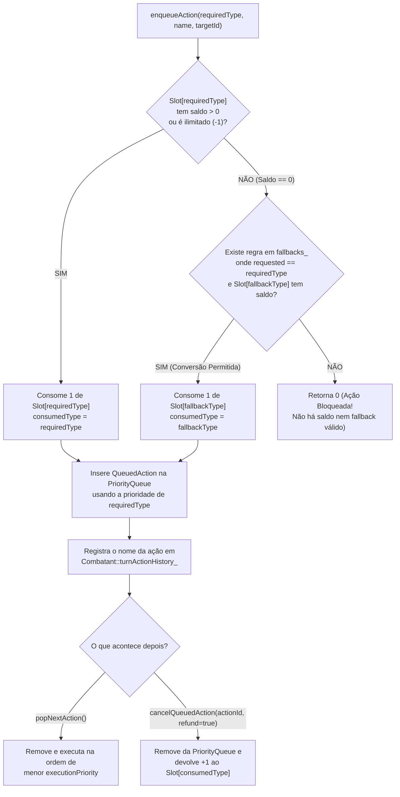

> **Detalhe Importante (Reembolso Exato):** Como cada `QueuedAction` guarda tanto o `requiredType` (que define a prioridade na fila) quanto o `consumedType` (qual slot realmente pagou a conta), se o jogador cancelar uma ação que usou *fallback*, o Core devolve o ponto exatamente para o slot que foi gasto!

---

### 3.3. `AbilityTree` & `RequirementTree` — Árvore de Habilidades + Árvore Lógica de Pré-requisitos
Este subsistema combina **duas árvores (`Tree<T>`) trabalhando em conjunto** para validar qualquer regra de concessão ou uso de habilidade:

1. **`AbilityTree` (`Tree<AbilityNode>`)**: Modela a hierarquia entre habilidades (qual poder é filho de qual poder).
2. **`RequirementTree` (`Tree<RequirementNode>`)**: Dentro de cada `AbilityNode`, existem **duas** árvores de expressão lógica avaliadas em **pós-ordem** (filhos avaliados antes do pai):
   - **`grantRequirements`**: Avaliada em `canLearn()` / `learn()` para saber se o personagem pode **adquirir/desbloquear** a habilidade.
   - **`usageRequirements`**: Avaliada em `canUse()` durante o combate para saber se o personagem pode **ativar** a habilidade naquele momento do turno.

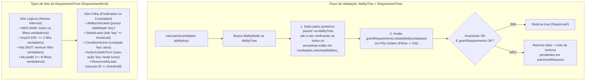

---

### 3.4. `ResourcePool`, Pipeline de `Damage` e `ConditionTracker`

#### Pipeline de Dano e Absorção por Recurso Temporário (`Damage.cpp` + `Resource.cpp`)
Quando `Encounter::dealDamage(targetId, rawAmount, damageType)` é chamado, o dano passa por um pipeline determinístico antes de tocar nos pontos de vida:

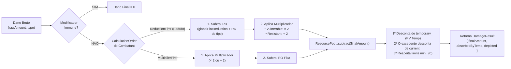

#### Ciclo de Vida e Empilhamento de Condições (`ConditionTracker`)
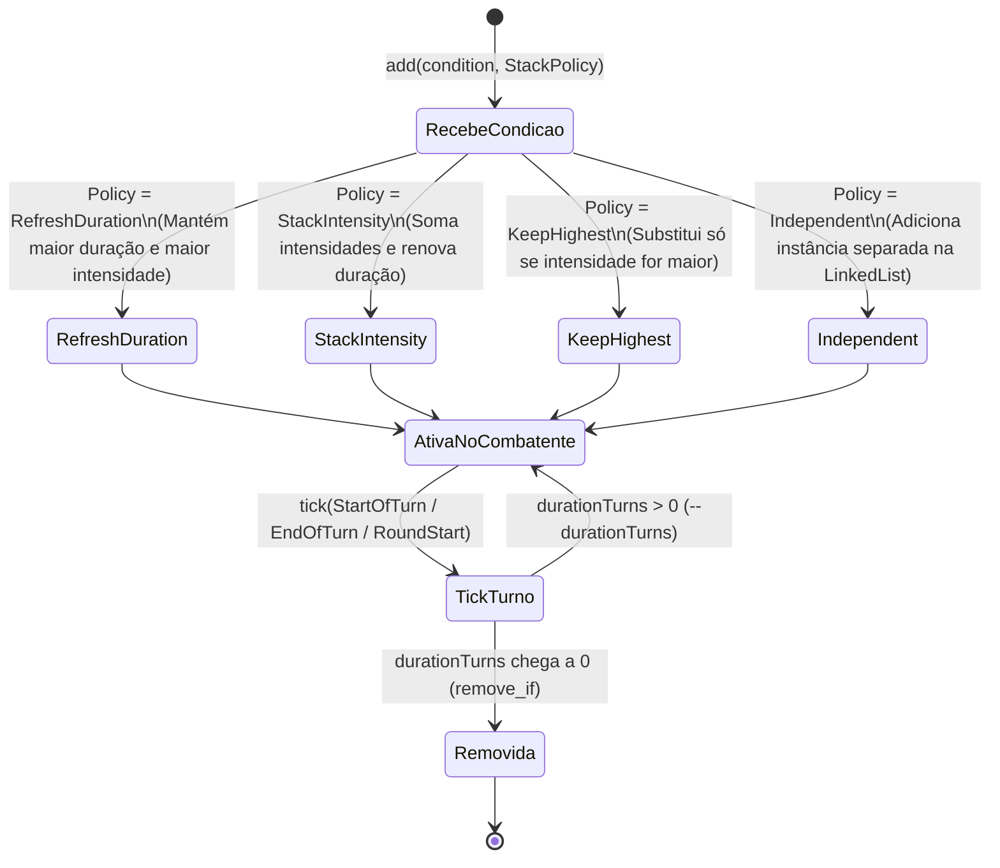

---

### 3.5. `DiceEngine` — Parser e Avaliador de Expressões de Dados
O `DiceEngine` processa fórmulas complexas sem depender de regras fixas de um único RPG:

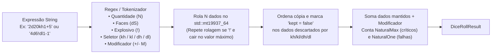

---

## 4. Representação Visual do Pacote de Regras de Tormenta20 em C# (`bindings/csharp/Tormenta20Rules.cs`)

Toda a lógica específica de **Tormenta20 — Edição Jogo do Ano** está isolada em C# dentro do namespace `OpenTTRPG.Tormenta20`, configurando o Core C++ via P/Invoke.

### 4.1. `Tormenta20ActionRules` — Fila de Prioridades e Conversão Unidirecional de Ações
Em Tormenta20 Jogo do Ano:
1. As ações agendadas no turno são executadas na ordem de prioridade: **1º Ação Livre $\rightarrow$ 2º Ação de Movimento $\rightarrow$ 3º Ação Padrão/Comum**.
2. Um personagem pode **gastar sua Ação Padrão para realizar uma Ação de Movimento adicional**, mas **NUNCA pode gastar uma Ação de Movimento para pagar uma Ação Padrão**.

Veja como `Tormenta20ActionRules.ConfigureTurnActions` configura isso no Core:

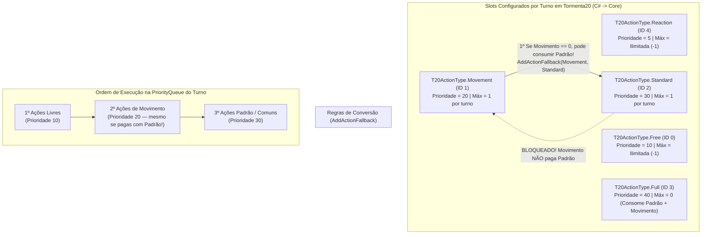

---

### 4.2. `Tormenta20AbilityTreeRules` — Topologia Completa da Árvore de Poderes de Tormenta20
O método `Tormenta20AbilityTreeRules.RegisterTormenta20PowerTrees(session)` constrói no Core C++ os **4 ramos canônicos de poderes de Tormenta20**, combinando hierarquia de árvore (`parentKey`), requisitos de aprendizado (`grantRequirements`) e requisitos de ativação no turno (`usageRequirements`):

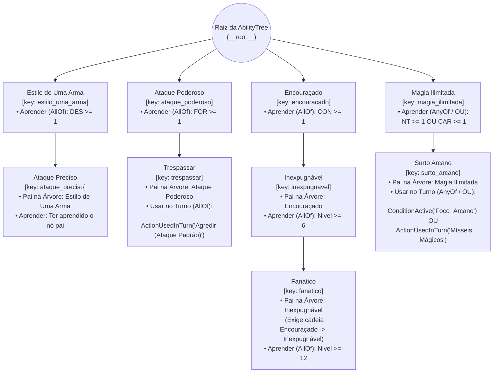

#### Exemplo Visual da Árvore de Requisitos (`RequirementTree`) de **Surto Arcano** e **Magia Ilimitada**
Para ilustrar como o `Tormenta20AbilityTreeRules` monta as `RequirementTree`s internas de um poder com lógica `OR` (`AnyOf`):

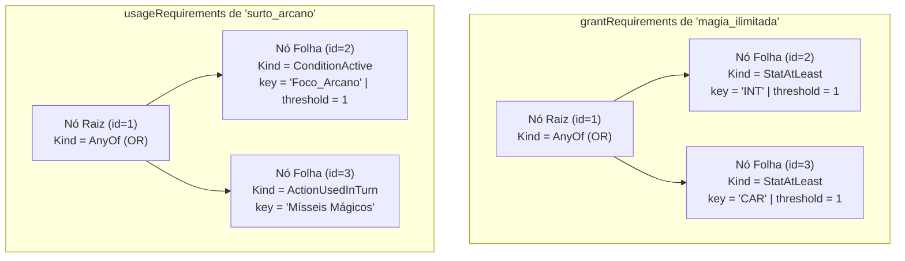

---

### 4.3. Diagrama de Sequência: Um Turno Completo de Combate (C# $\leftrightarrow$ C ABI $\leftrightarrow$ Core C++)

O diagrama abaixo mostra o que acontece nos bastidores durante um turno em que **Valeros** tenta usar *Trespassar* antes de atacar (sendo bloqueado pela árvore), realiza um *Ataque Padrão* (desbloqueando *Trespassar*), usa *Ataque Especial* (Ação Livre) e encerra o turno executando a Fila de Prioridades na ordem correta:

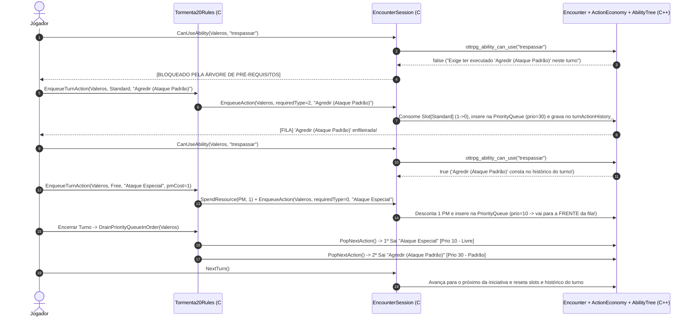

---

## 5. Documentos Relacionados

* **[Guia de Integração com a Interface Gráfica (`docs/ui_integration_guide.md`)](ui_integration_guide.md):** Mostra exatamente quais métodos de `EncounterSession` e `Tormenta20Rules` chamar em cada botão e tela do Godot Engine + C#.
* **[Regras de Tormenta20 (`docs/tormenta20_rules.md`)](tormenta20_rules.md):** Referência das fórmulas e tabelas oficiais de Tormenta20 Jogo do Ano.
* **[To-Do List (`To_Do_List.md`)](../To_Do_List.md):** Roadmap atualizado do projeto.
