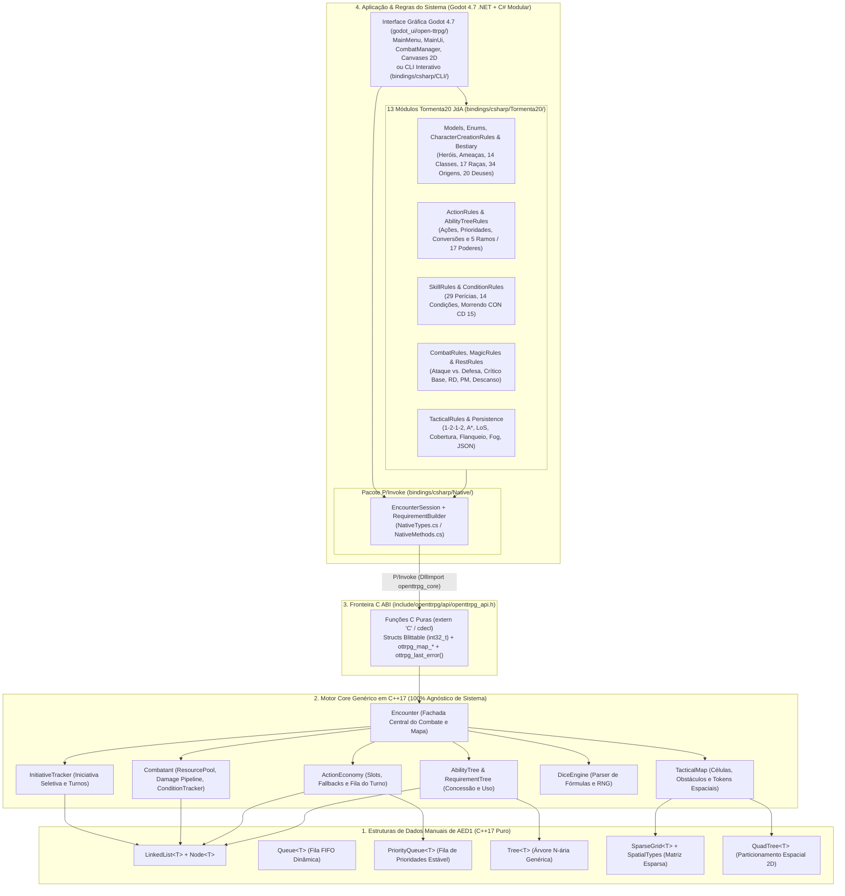
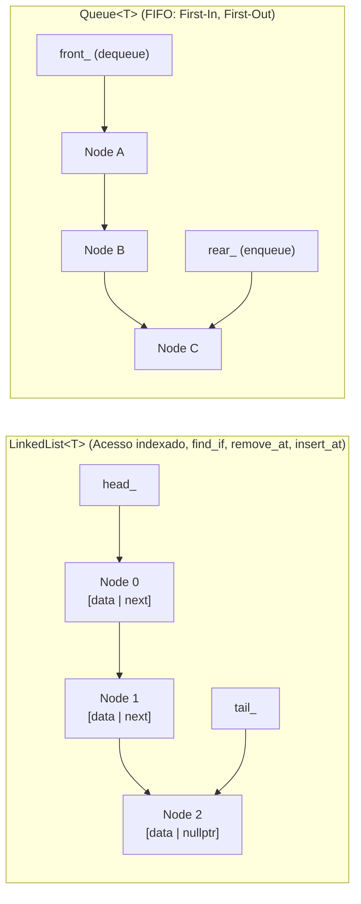
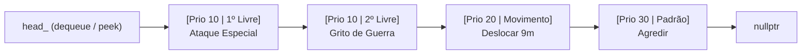
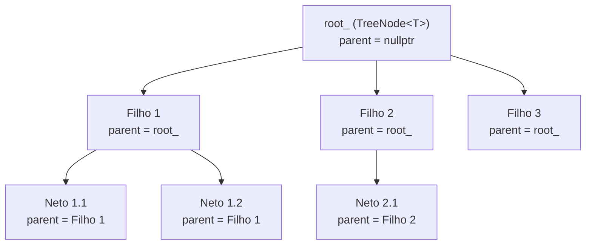
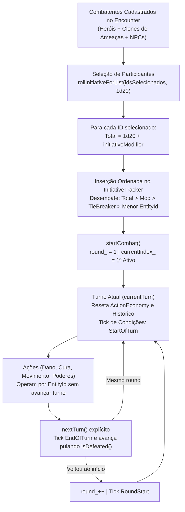

# Arquitetura e Representação Visual do Sistema — OpenTTRPG

Este documento apresenta a engenharia de software e a **representação visual detalhada** de cada subsistema das **6 Estruturas de Dados Manuais de AED1**, do **Core Genérico em C++17**, da **Fronteira C ABI**, do **Pacote Modular de 13 arquivos de Tormenta20 (JdA) em C#** e da **Interface Gráfica em Godot Engine 4.7 (.NET)**.

---

## 1. Visão Macro: Arquitetura em 4 Camadas e Fronteira Nativa (P/Invoke)

O **OpenTTRPG** separa estritamente **mecanismos universais de RPG** (em C++17) de **regras específicas de um sistema** (em C#). Nenhum arquivo C++ conhece o que é "Tormenta20", "Pontos de Mana", "Luta" ou "Goblin Salteador" — tudo no C++ opera sobre identificadores genéricos (`EntityId`, `ResourceId`, `DamageTypeId`, `ActionTypeId`) e coordenadas em grade (`GridPos`).

---

## 2. Estruturas de Dados Manuais de AED1 (`include/openttrpg/data_structures/`)

Todas as **6 estruturas** foram implementadas manualmente do zero com ponteiros e alocação dinâmica (`new` / `delete`), obedecem à **Regra dos Cinco (*Rule of Five*)** e são auditadas contra vazamentos de memória via `make test_asan` (`-fsanitize=address,leak`).

### 2.1. `LinkedList<T>` (`Node<T>`) e `Queue<T>`

### 2.2. `PriorityQueue<T>` (Fila de Prioridades Ordenada Estável)
Elementos com **menor valor numérico de `priority`** saem primeiro na frente da fila. Em caso de **empate de prioridade**, preserva-se a ordem exata de chegada (**estabilidade FIFO**):

* **Inserção (`enqueue(value, priority)`):** Percorre a lista enquanto `curr->priority <= priority` e insere o novo nó após o último elemento de mesma prioridade ($O(N)$), garantindo estabilidade.
* **Remoção seletiva (`remove_if`):** Permite cancelar uma ação específica no meio da fila ao clicar em desfazer na UI e devolver o slot/PM ao combatente.

### 2.3. `Tree<T>` (Árvore N-ária Genérica)
Cada `TreeNode<T>` possui um ponteiro `parent` (subindo até a raiz em $O(h)$ para validar ancestralidade) e uma `LinkedList<TreeNode<T>*> children` (número ilimitado de filhos por nó):

### 2.4. `SparseGrid<T>` (`SpatialTypes.hpp`) e `QuadTree<T>` (Estruturas Espaciais 2D)
Projetadas para sustentar mapas táticos grandes sem alocar matrizes densas cheias de células vazias nem perder eficiência em consultas de área:

* **`SparseGrid<T>` (Matriz Esparsa com Encadeamento Ortogonal):** Armazena apenas as células com conteúdo relevante (terreno difícil, paredes, pilares de cobertura) usando nós ligados ortogonalmente por linha (`right`) e coluna (`down`), oferecendo leitura/escrita em $O(1)$ amortizado ou $O(\text{células na linha})$ e limpeza automática quando uma célula retorna ao valor padrão.
* **`QuadTree<T>` (Árvore Quaternária Espacial 2D):** Subdivide recursivamente o retângulo do mapa em 4 quadrantes (`NW`, `NE`, `SW`, `SE`) usando `GridRect`, `GridPos` e `SpatialItem<T>` definidos em [`SpatialTypes.hpp`](../include/openttrpg/data_structures/SpatialTypes.hpp). Quando um nó excede a capacidade de folha, ele se subdivide e permite consultas rápidas de tokens por região (`queryRange`), raio e vizinhança para flanqueamento e alcance de ataques.

---

## 3. Subsistemas do Core C++ (`include/openttrpg/core/` e `src/core/`)

### 3.1. `InitiativeTracker` & `Encounter` — Seleção de Participantes e Ciclo de Turnos
No Core, cadastrar um combatente não o força a entrar na iniciativa. `rollInitiativeForList` recebe apenas os IDs selecionados para participar daquele combate, rola a iniciativa e ordena a lista:

### 3.2. `ActionEconomy` — Slots, Conversão Direcional (`Fallback`), Custos Compostos e Fila
Gerencia `ActionSlot`s, regras direcionais `ActionFallbackRule` (`requestedType -> fallbackType`) e uma `PriorityQueue<QueuedAction>`:
* **Ações Compostas (`enqueueCompoundAction`):** Usadas na **Ação Completa** (consome `1 Ação Padrão + 1 Ação de Movimento` atomicamente; se cancelada antes da execução, devolve ambos os slots).
* **Ordem de Prioridades:** `Reação (5)` $\rightarrow$ `Livre (10)` $\rightarrow$ `Movimento (20)` $\rightarrow$ `Padrão (30)` $\rightarrow$ `Completa (40)`.

### 3.3. `AbilityTree` & `RequirementTree` — Árvore de Habilidades + Árvore Lógica
Combina duas árvores (`Tree<T>`):
1. **`AbilityTree` (`Tree<AbilityNode>`):** Hierarquia entre poderes (exigindo todos os ancestrais desbloqueados até a raiz).
2. **`RequirementTree` (`Tree<RequirementNode>`):** Avalia em pós-ordem expressões lógicas (`AllOf`, `AnyOf`, `Not`, `AtLeastN`) sobre predicados no combatente (`AbilityUnlocked`, `StatAtLeast`, `ConditionActive`, `ActionUsedInTurn`, `ResourceAtLeast`) tanto para aprender (`grantRequirements`) quanto para ativar no turno (`usageRequirements`).

### 3.4. `ResourcePool`, Pipeline de `Damage` e `ConditionTracker`
Quando `Encounter::dealDamage(targetId, rawAmount, damageType)` é chamado:
1. Verifica imunidades (`Immune` $\rightarrow$ dano `0`).
2. Aplica Redução de Dano (`ReductionFirst`, padrão em T20) e multiplicadores (`Vulnerable` $\times 2$, `Resistant` $\div 2$).
3. `ResourcePool::subtract(finalAmount)` consome primeiro `temporary_` (PV Temporário), depois `current_` até `min_` (permitindo valores negativos no `ResourcePool` para representar o limiar de morte do Estado de Morrendo em Tormenta20).

### 3.5. `TacticalMap` & C ABI (`ottrpg_map_*`)
[`TacticalMap.hpp`](../include/openttrpg/core/TacticalMap.hpp) une **`SparseGrid<MapCellData>`** (para guardar apenas células não-padrão com terreno, nível de cobertura e bloqueio de visão) e **`QuadTree<EntityId>`** (para indexar e consultar tokens vivos nas coordenadas do tabuleiro). Toda a API espacial é exportada em [`openttrpg_api.h`](../include/openttrpg/api/openttrpg_api.h) sob o prefixo **`ottrpg_map_*`** (`ottrpg_map_reset`, `ottrpg_map_set_cell`, `ottrpg_map_get_cell`, `ottrpg_map_place_token`, `ottrpg_map_move_token`, `ottrpg_map_remove_token`, `ottrpg_map_get_token_position`, `ottrpg_map_query_radius`, etc.), consumida por [`EncounterSession.cs`](../bindings/csharp/Native/EncounterSession.cs).

---

## 4. Pacote Modular de Tormenta20 em C# (`bindings/csharp/Tormenta20/`)

A camada específica de **Tormenta20 — Edição Jogo do Ano** é composta por **13 módulos** (`namespace OpenTTRPG.Tormenta20`):

| Módulo C# | Responsabilidade Principal | Números / Regras Verificadas |
| :--- | :--- | :--- |
| `Tormenta20Enums.cs` | Catálogo tipado de opções do sistema | **14 Classes**, **17 Raças**, **34 Origens**, **20 Deuses Maiores** (+ `NaoDevoto`), **14 Condições**, **6 Atributos**, `T20HealthState`, `RestQuality`, `T20DamageType`, `T20ActionType`, `ItemType`. |
| `Tormenta20Models.cs` | Modelo unificado `CharacterSheetData` e `CharacterItem` | Suporta Heróis e Inimigos/Ameaças (`IsEnemy`, `ChallengeRating`, `FixedDefense`, `DamageReduction`, `SpeedMetersOverride`, overrides de perícias), `GetDeathThreshold()` (`-max(10, MaxHp/2)` vs `0`), `CloneForCombat()` e `AttackBonus`. |
| `Tormenta20CharacterCreationRules.cs` | Criação e progressão automática | Templates oficiais de Raças/Classes calculando PV, PM, Defesa, deslocamento, perícias e equipamento inicial automaticamente. |
| `Tormenta20Bestiary.cs` | Catálogo de Ameaças / Bestiário | **8 presets canônicos T20 JdA** (`goblin_salteador` ND 1/4 até `dragao_jovem` ND 7) + `CreateBlankEnemy()`. |
| `Tormenta20ActionRules.cs` | Economia de Ações no turno | Registra `Reaction (5)`, `Free (10)`, `Movement (20)`, `Standard (30)`, `Full (40)` e fallback `Padrão -> Movimento`. |
| `Tormenta20AbilityTreeRules.cs` | Árvore N-ária de Poderes | **5 ramos / 17 poderes canônicos**: `1. Esgrima (DES)`, `2. Brutalidade (FOR)`, `3. Bastião (CON)`, `4. Arcanismo (INT/CAR)` e `5. Arquearia (DES)`. |
| `Tormenta20SkillRules.cs` | Testes e perícias | **29 perícias canônicas**, bônus de treino `+2`/`+4`/`+6`, penalidade de armadura/sobrecarga e overrides de ameaças. |
| `Tormenta20ConditionRules.cs` | Catálogo de condições e Morrendo | **14 condições canônicas**, escalonamento `Abalado -> Apavorado`, restrições de ação e teste de **Sangramento/Morrendo (`CON CD 15`)**. |
| `Tormenta20CombatRules.cs` | Resolução de ataques e dano | `1d20 + Ataque` vs Defesa, crítico apenas nos dados base, bônus táticos (flanqueamento `+2` / cobertura `+5`), `AttackBonus` de ameaças sem somar FOR duplicada e pipeline de RD. |
| `Tormenta20MagicRules.cs` | Magias e aprimoramentos | Validação de custo cumulativo e limite de gasto de PM por nível (ou `Nível + Atributo-Chave` com *Magia Ilimitada*). |
| `Tormenta20RestRules.cs` | Descanso entre encontros | Recuperação de PV/PM para descansos *Ruim*, *Normal*, *Confortável* e *Luxuoso*. |
| `Tormenta20TacticalRules.cs` | Regras táticas de tabuleiro | Grade `1q = 1,5m`, diagonais `1-2-1-2`, A\*/Dijkstra, Correr (`2x` Completa), Terreno Difícil (`2x`), LoS Supercover, Cobertura Leve (`+5`), Flanqueamento (`+2`), 4 presets de arena e `TacticalFogTracker`. |
| `Tormenta20Persistence.cs` | Serialização JSON (`System.Text.Json`) | DTOs completos e leitura/escrita para `characters.json`, `enemies.json` e `encounter_snapshot.json` (com `TacticalMapSnapshotDto` e `InlineSheet`). |

---

## 5. Arquitetura da Interface Gráfica Godot 4.7 (`godot_ui/open-ttrpg/`)

A camada visual roda em **Godot Engine 4.7 (.NET / C#)** conectada diretamente aos assemblies de `bindings/csharp/Native/` e `bindings/csharp/Tormenta20/`:

* **`scripts/CombatManager.cs` (Autoload Global):** Configura `NativeLibrary.SetDllImportResolver` (garantindo carregamento de `libopenttrpg_core.so` no Linux e `openttrpg_core.dll` no Windows tanto no editor quanto em builds exportadas), mantém a `EncounterSession` ativa, gerencia `Characters`, `Enemies`, clones temporários de combate (`_transientCombatSheets`), `TacticalFogTracker` e a resolução portátil da pasta `saves/`.
* **`Cenas/MainMenu.tscn` / `MainMenu.cs`:** Tela inicial com acesso direto para iniciar/gerenciar fichas, abrir o combate e carregar a mesa.
* **`Cenas/MainUi.tscn` / `MainUi.cs`:** Hub principal dividido em abas navegáveis:
  * **Ficha (Heróis):** Layout com partições redimensionáveis (`HSplitFicha` e `VSplitLeftCol`), seletores automáticos de Raça/Classe/Origem/Divindade, barras de PV/PM/PV Temp, Estado de Morrendo, perícias clicáveis, inventário/loja em `T$` e gasto direto de habilidades/magias.
  * **Inimigos (Bestiário):** Criação e edição de fichas próprias de ameaças (ND, Tipo, Tamanho, Papel, Defesa Fixa, RD, deslocamento, ataques com `AttackBonus` e overrides de perícias).
  * **Combate:** Lobby de seleção de participantes com suporte a múltiplos clones de ameaças (`x1..x8`), barra superior de iniciativa, fila de prioridades de ações com desfazer e log detalhado.
  * **Mapa Tático (Tabletop):** Grade interativa com editor de cenário/presets, modo Névoa de Guerra (Visão do Mestre vs Heróis), tokens de combate e **aba Ajuda** embutida com comandos e regras táticas.
  * **Pop-ups & Modais:** **Bandeja de Dados** flutuante (`DiceVisualCanvas.cs` com renderização procedural e `CpuParticles2D`) e **Árvore de Poderes** (`AbilityTreeCanvas.cs` exibindo os 5 ramos / 17 nós).
* **`scripts/TacticalGridCanvas.cs`:** Renderizador 2D do tabuleiro com câmera suave (zoom interpolado exponencialmente centrado no cursor, pan com botão direito/meio ou `Espaço + arrastar` e proteção contra cliques acidentais durante o arrasto).

---

## 6. Qualidade, Testes e Documentos Relacionados

O projeto é validado por **4 níveis de verificação automatizada**:
* **7 suítes AED1 (`tests/test_data_structures.cpp`):** Validam `LinkedList`, `Queue`, `PriorityQueue`, `Tree`, `SparseGrid` e `QuadTree` (também sob `make test_asan` com `0` leaks).
* **11 suítes Core/C ABI (`tests/test_generic_core.cpp`):** Validam `DiceEngine`, `ResourcePool`, `Damage`, `ConditionTracker`, `InitiativeTracker`, `ActionEconomy`, `RequirementTree`, `TacticalMap` e funções `ottrpg_*`.
* **13 testes C# (`bindings/csharp/Tests/Tormenta20Tests.cs`):** Validam todas as regras de Tormenta20 e a interoperabilidade P/Invoke.
* **8/8 etapas `--self-test` (`MainUi.cs`):** Executam o fluxo completo UI Godot $\leftrightarrow$ C# $\leftrightarrow$ C++ em modo `--headless`.

### Guias Complementares
* **[Regras de Tormenta20 (`docs/tormenta20_rules.md`)](tormenta20_rules.md):** Referência completa das fórmulas, bestiário, criação automática, morrendo e regras táticas.
* **[Persistência de Dados JSON (`docs/data_persistence_guide.md`)](data_persistence_guide.md):** Detalhes dos arquivos `characters.json`, `enemies.json`, `encounter_snapshot.json` e seus DTOs.
* **[Guia da Interface Gráfica Godot 4.7 (`docs/ui_integration_guide.md`)](ui_integration_guide.md):** Mapeamento de botões/telas para métodos C# e C ABI, controles do Tabletop e diretrizes visuais.
* **[Guia de Build e Release Multiplataforma (`docs/release_build_guide.md`)](release_build_guide.md):** Empacotamento Linux/Windows, linkagem estática MinGW, fallback offline `.NET 8.0.32` e diagnóstico `--self-test`.
* **[To-Do List (`To_Do_List.md`)](../To_Do_List.md):** Histórico completo das 7 etapas do roadmap.
