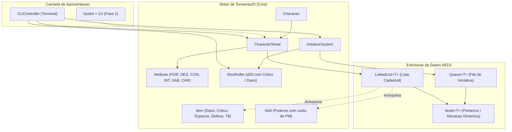

# Arquitetura e Engenharia de Software — OpenTTRPG

Projeto desenvolvido no contexto acadêmico de **Algoritmos e Estruturas de Dados 1 (AED1 - UFSCar)**, implementando as regras oficiais de **Tormenta20 — Edição Jogo do Ano (T20 JdA)**.

---

## 1. Visão Geral do Sistema

O projeto é construído em **C++17 puro** com arquitetura desacoplada em três camadas:

1. **Camada de Estruturas de Dados (AED1):**
   Implementações manuais de estruturas de dados lineares sem o uso de containers da STL para as estruturas avaliadas pela disciplina.
2. **Camada de Domínio / Regras de Negócio (Tormenta20 JdA):**
   Modelos orientados a objetos que implementam fichas, atributos, inventário com cálculo de espaços, magias com Pontos de Mana (PM) e rolagem de dados com críticos.
3. **Camada de Apresentação (CLI na Fase 1 / Godot Engine na Fase 2):**
   Interface textual rica via terminal na Fase 1, desenhada para ser compilada como biblioteca compartilhada (`.so`/`.dll`) e consumida via P/Invoke em C# na Fase 2.



---

## 2. Estrutura de Diretórios

```text
OpenTTRPG/
├── docs/                               # Documentação técnica e de regras
│   ├── architecture.md                 # Arquitetura e padrões do sistema
│   └── tormenta20_rules.md             # Regras canônicas de Tormenta20 Jogo do Ano
├── include/                            # Cabeçalhos (.hpp)
│   └── openttrpg/
│       ├── core/                       # Tipos fundamentais de T20 (AttributeType, ItemType, ActionType)
│       │   └── Types.hpp
│       ├── data_structures/            # Estruturas manuais com alocação dinâmica (AED1)
│       │   ├── Node.hpp                # Nó encadeado genérico
│       │   ├── LinkedList.hpp          # Lista Simplesmente Encadeada com gerenciamento de memória
│       │   └── Queue.hpp               # Fila FIFO para sistema de turnos
│       ├── models/                     # Entidades do RPG Tormenta20
│       │   ├── Attribute.hpp           # 6 Atributos canônicos com modificador direto de T20
│       │   ├── Item.hpp                # Itens com dano, margem de crítico, espaços e tibares
│       │   ├── Skill.hpp               # Habilidades de classe e magias com custo em PM
│       │   ├── CharacterSheet.hpp      # Ficha de personagem com PV, PM, Defesa e Carga
│       │   └── Character.hpp           # Combatente ativo em sessão
│       ├── systems/                    # Mecânicas do jogo
│       │   ├── DiceRoller.hpp          # Rolagem com detecção de 20 e 1 natural
│       │   └── InitiativeSystem.hpp    # Fila de combate e rotação de turnos
│       └── cli/
│           └── CLIController.hpp       # Controlador da interface do terminal
├── src/                                # Implementações em C++ (.cpp)
│   ├── models/
│   │   ├── Attribute.cpp
│   │   ├── Item.cpp
│   │   ├── Skill.cpp
│   │   ├── CharacterSheet.cpp
│   │   └── Character.cpp
│   ├── systems/
│   │   ├── DiceRoller.cpp
│   │   └── InitiativeSystem.cpp
│   ├── cli/
│   │   └── CLIController.cpp
│   └── main.cpp                        # Ponto de entrada CLI
├── tests/
│   └── test_data_structures.cpp        # Bateria de testes unitários automatizados
├── Makefile                            # Build script com targets: all, test, run, clean
├── CMakeLists.txt                      # Script para compilação modular no CMake
└── .gitignore                          # Exclusão de binários e artefatos de compilação
```

---

## 3. Gerenciamento de Memória (RAII e Princípios de AED1)

As estruturas lineares em `include/openttrpg/data_structures/`:
* Utilizam operadores `new` e `delete` para manipulação de nós dinâmicos (`Node<T>`).
* Respeitam a **Regra dos Cinco (Rule of Five)** em C++:
  * Destrutor que percorre e desaloca todos os nós (`clear()`), prevenindo *memory leaks*.
  * Construtor de cópia profunda (*deep copy*) para clonagem segura de listas e filas.
  * Operador de atribuição por cópia (*copy assignment*).
  * Construtor de movimento (*move constructor*) com transferência de ponteiros `noexcept`.
  * Operador de atribuição por movimento (*move assignment*).

---

## 4. Como Compilar e Executar

### Pré-requisitos
* Compilador C++ com suporte a **C++17** (`g++` versão 9 ou superior).
* Utilitário `make`.

### Comandos de Terminal

* **Compilar e Rodar os Testes Unitários:**
  ```bash
  make test
  ```
* **Compilar o Executável da Aplicação CLI:**
  ```bash
  make all
  ```
* **Executar a Aplicação:**
  ```bash
  make run
  ```
* **Limpar os Artefatos de Compilação (`build/` e `bin/`):**
  ```bash
  make clean
  ```
