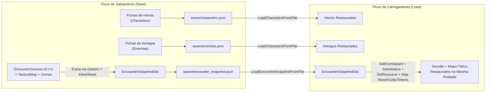

# Persistência de Dados (JSON) — OpenTTRPG

Este documento descreve o subsistema de **Persistência de Dados em JSON**, implementado inteiramente na camada C# em [`bindings/csharp/Tormenta20/Tormenta20Persistence.cs`](../bindings/csharp/Tormenta20/Tormenta20Persistence.cs) com `System.Text.Json` e integrado à interface gráfica via [`godot_ui/open-ttrpg/scripts/CombatManager.cs`](../godot_ui/open-ttrpg/scripts/CombatManager.cs).

Toda a serialização e reconstrução de sessões ocorre na camada gerenciada em C#, mantendo o motor Core C++ (`libopenttrpg_core.so` / `openttrpg_core.dll`) livre de acoplamento com formatos de arquivo.

---

## 1. Arquivos Gerenciados na Pasta `saves/`

O sistema gerencia **3 arquivos JSON** distintos dentro do diretório `saves/`:

1. **`saves/characters.json` (Fichas de Heróis):**
   - Armazena uma lista de `CharacterSheetDto` contendo todas as fichas de personagens jogadores (`IsEnemy = false`).
   - Preserva: identidade (`Id`, `Name`, `CharacterClass`, `Race`, `Origin`, `Deity`, `Level`, `Tibares`, `SpellKeyAttribute`), recursos (`MaxHp`, `CurrentHp`, `TempHp`, `MaxPm`, `CurrentPm`, `IsBleedingOut`), os 6 atributos, `Inventory` (`CharacterItemDto` com `AttackBonus`), `Skills` (`CharacterSkillDto` + `SpellEnhancementDto`), `UnlockedTreeKeys`, `TrainedSkills` e `SkillMiscBonuses`.

2. **`saves/enemies.json` (Fichas de Inimigos / Bestiário Customizável):**
   - Armazena a biblioteca persistente de ameaças/inimigos (`IsEnemy = true`), separada das fichas de heróis para manter a aba **Inimigos** independente.
   - Além dos campos comuns da ficha, preserva os metadados próprios de ameaças de Tormenta20 JdA: `ChallengeRating`, `CreatureType`, `CreatureSize`, `ThreatRole`, `SpeedMetersOverride`, `FixedDefense`, `DamageReduction`, `ThreatAttackBonus`, overrides opcionais (`InitiativeOverride`, `PerceptionOverride`, `FortitudeOverride`, `ReflexOverride`, `WillOverride`), `SensesNotes`, `TreasureNotes` e `ThreatNotes`.

3. **`saves/encounter_snapshot.json` (Snapshot Completo de Combate + Mapa Tático):**
   - Extrai o estado vivo da `EncounterSession` em C++ e o serializa junto ao estado do tabuleiro tático para permitir salvar e retomar uma batalha exatamente no mesmo turno e rodada.
   - Inclui suporte a múltiplos **clones de ameaças (`x1..x8`)** instanciados apenas durante o combate por meio de `CombatantSnapshotDto.InlineSheet`, evitando poluir `enemies.json` com cópias temporárias e garantindo restauração fiel ao recarregar.

---

## 2. Esquema Completo de DTOs (`Tormenta20Persistence.cs`)

| Classe DTO | Papel no JSON | Principais Campos |
| :--- | :--- | :--- |
| **`CharacterSheetDto`** | Representação portável de `CharacterSheetData` (Herói ou Inimigo) | `Id`, `Name`, `CharacterClass`, `Race`, `Origin`, `Deity`, `Level`, `MaxHp`, `CurrentHp`, `TempHp`, `MaxPm`, `CurrentPm`, `Strength..Charisma`, `DefenseBonusMisc`, `Tibares`, `SpellKeyAttribute`, `IsBleedingOut`, `IsEnemy`, `ChallengeRating`, `CreatureType`, `CreatureSize`, `ThreatRole`, `SpeedMetersOverride`, `FixedDefense`, `DamageReduction`, `ThreatAttackBonus`, `*Override`, `SensesNotes`, `TreasureNotes`, `ThreatNotes`, `Inventory`, `Skills`, `UnlockedTreeKeys`, `TrainedSkills`, `SkillMiscBonuses`. |
| **`CharacterItemDto`** | Itens, armas, armaduras e escudos do inventário | `Name`, `Description`, `Type`, `Slots`, `Damage`, `Critical`, `DamageType`, `IsRanged`, `DefenseBonus`, `ArmorPenalty`, `Price`, `Equipped`, `AttackBonus`. |
| **`CharacterSkillDto`** & **`SpellEnhancementDto`** | Poderes ativos, magias e aprimoramentos | `Name`, `Description`, `PmCost`, `Action`, `Modifier`, `TreeKey`, `IsSpell`, `BaseFormula`, `Enhancements` (`ExtraPmCost`, `Description`, `ExtraDice`). |
| **`CombatantSnapshotDto`** | Estado individual de cada participante da iniciativa | `SheetId`, `Name`, `TeamId`, `Initiative`, `MaxHp`, `CurrentHp`, `TempHp`, `MaxPm`, `CurrentPm`, `IsBleedingOut`, `ActiveConditions`, `InlineSheet` (`CharacterSheetDto?` completo para clones de inimigos ou combatentes não salvos na lista fixa). |
| **`TacticalMapSnapshotDto`**, **`MapCellDto`**, **`GridPosDto`** | Estado completo do Tabletop 2D associado ao combate | `Width`, `Height`, `BackgroundImagePath`, `FogOfWarEnabled`, `Cells` (`X`, `Y`, `Terrain`, `CoverLevel`, `BlocksSight`), `TokenPositions` (`Dictionary<int, GridPosDto>`) e `ExploredCells`. |
| **`EncounterSnapshotDto`** | Raiz de `encounter_snapshot.json` | `CombatStarted`, `Round`, `CurrentTurnSheetId`, `Participants` (`List<CombatantSnapshotDto>`) e `TacticalMap` (`TacticalMapSnapshotDto?`). |

### API Pública de `Tormenta20Persistence`
* `Tormenta20Persistence.ToDto(CharacterSheetData sheet)` e `FromDto(CharacterSheetDto dto)`
* `Tormenta20Persistence.SaveCharactersToFile(IEnumerable<CharacterSheetData> sheets, string filePath)`
* `Tormenta20Persistence.LoadCharactersFromFile(string filePath)`
* `Tormenta20Persistence.SaveEncounterSnapshotToFile(EncounterSnapshotDto snapshot, string filePath)`
* `Tormenta20Persistence.LoadEncounterSnapshotFromFile(string filePath)`

---

## 3. Resolução Portátil de Caminhos no Godot (`CombatManager.cs`)

Para que o salvamento funcione de forma transparente tanto durante o desenvolvimento no Editor quanto em pastas compactadas (`.zip` / `.tar.gz`) de release para Linux e Windows, [`CombatManager.cs`](../godot_ui/open-ttrpg/scripts/CombatManager.cs) resolve automaticamente os caminhos através de `GetCharactersSavePath()`, `GetEnemiesSavePath()` e `GetCombatSnapshotPath()`:

1. **Rodando pelo Editor Godot (`OS.HasFeature("editor")`):**
   - Prioriza `res://../../saves/` (a pasta `saves/` na raiz do repositório), mantendo o arquivo `saves/characters.json` compartilhado entre CLI, testes e UI.
2. **Rodando como Release Exportada (`OpenTTRPG.x86_64` / `OpenTTRPG.exe`):**
   - Prioriza `saves/` diretamente ao lado do executável distribuído (`Path.Combine(exeDir, "saves", ...)`), garantindo portabilidade total ao compactar e enviar a release para outro computador.
   - Se o executável estiver rodando dentro de `bin/release/linux-x64` ou `bin/release/win-x64` no repositório e não houver `saves/` local, faz fallback para `../../../saves/`.
3. **Migração Legada Automática:**
   - Caso um arquivo `characters.json` antigo contenha fichas marcadas com `IsEnemy = true`, `CombatManager.LoadCharacters()` move essas fichas automaticamente para a coleção `Enemies` na inicialização.
4. **Seeding Inicial:**
   - Se `enemies.json` ainda não existir na pasta de saves, `CombatManager.LoadEnemies()` gera e salva um conjunto inicial de ameaças a partir de `Tormenta20Bestiary`.

---

## 4. Fluxo de Restauração de Combate + Mapa Tático

Ao carregar `saves/encounter_snapshot.json`:
1. A sessão nativa (`EncounterSession`) é reinicializada com `Tormenta20AbilityTreeRules.RegisterTormenta20PowerTrees(Session)`.
2. Para cada `CombatantSnapshotDto` em `Participants`:
   - Localiza a ficha correspondente em `Characters` ou `Enemies`; se for um clone/instância transitória, reconstrói a partir de `dto.InlineSheet` via `Tormenta20Persistence.FromDto(...)`.
   - Re-registra o combatente no Core C++ (`AddCombatant`), restaura `CurrentHp`, `TempHp`, `CurrentPm`, `IsBleedingOut`, reaplica `ActiveConditions` e restaura a iniciativa exata salva usando `Session.SetInitiative(coreId, dto.Initiative)` (determinístico, sem re-rolar dados).
3. Se `snapshot.CombatStarted` for `true`, chama `Session.StartCombat()` e avança `NextTurn()` até restaurar o `CurrentTurnSheetId` exato.
4. Se `snapshot.TacticalMap != null`, reconstrói as dimensões do grid (`ResetMap`), todas as células modificadas (`SetMapCell`), todas as posições de tokens (`PlaceToken`), a imagem de fundo e o estado de Névoa de Guerra (`FogOfWarEnabled` e `ExploredCells`).

---

## 5. Checklist de Conclusão

1. [x] Criar [`bindings/csharp/Tormenta20/Tormenta20Persistence.cs`](../bindings/csharp/Tormenta20/Tormenta20Persistence.cs) com DTOs e métodos de salvar/carregar fichas de heróis, inimigos e snapshot completo de combate + mapa.
2. [x] Integrar persistência automática e botões de salvar/carregar no [`CLIController.SheetMenu.cs`](../bindings/csharp/CLI/CLIController.SheetMenu.cs), [`CLIController.CombatMenu.cs`](../bindings/csharp/CLI/CLIController.CombatMenu.cs) e [`CombatManager.cs`](../godot_ui/open-ttrpg/scripts/CombatManager.cs) (`characters.json`, `enemies.json`, `encounter_snapshot.json`).
3. [x] Validar com testes unitários automatizados em [`bindings/csharp/Tests/Tormenta20Tests.cs`](../bindings/csharp/Tests/Tormenta20Tests.cs) (`TestCharacterPersistence` e `TestEnemyThreatSheetsAndBestiary`) e no `--self-test` 8/8 da UI Godot.
4. [x] Confirmar execução limpa de `make test` e `make test_asan` sem regressões ou vazamentos de memória.
5. [x] Marcar todos os requisitos de Persistência como concluídos no [`To_Do_List.md`](../To_Do_List.md).
