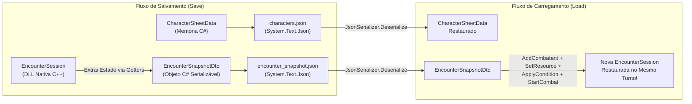

# Guia de Implementação: Persistência de Dados (JSON) — OpenTTRPG

Este documento foi elaborado especialmente para guiar a pessoa responsável por implementar a **Persistência de Dados (Salvar e Carregar em JSON no C#)**, correspondente ao item pendente da **Parte 4** do [`To_Do_List.md`](../To_Do_List.md).

Toda a persistência deve ser feita **100% na camada C#** utilizando a biblioteca nativa do .NET (`System.Text.Json`), sem necessidade de alterar o código C++ do Core.

---

## 1. Visão Geral: O Que Precisa Ser Salvo e Carregado?

Existem **dois escopos de persistência** no projeto:

1. **Persistência de Fichas de Personagens (`CharacterSheetData`)**:
   - Salvar e carregar uma ficha individual ou uma lista de personagens (`List<CharacterSheetData>`) em um arquivo `.json` (ex.: `saves/characters.json`).
   - Deve preservar: Dados básicos (`Id`, `Name`, `CharacterClass`, `Race`, `Origin`, `Deity`, `Level`, `Tibares`, `SpellKeyAttribute`), Recursos (`MaxHp`, `CurrentHp`, `TempHp`, `MaxPm`, `CurrentPm`), os 6 Atributos (`Strength`, `Dexterity`, `Constitution`, `Intelligence`, `Wisdom`, `Charisma`), `Inventory` (`CharacterItem`), `Skills` (`CharacterSkill` + `SpellEnhancement`), `UnlockedTreeKeys`, `TrainedSkills` e `SkillMiscBonuses`.

2. **Persistência de Snapshot de Combate (`EncounterSession` + Fichas)**:
   - Como o motor de combate (`EncounterSession`) vive na memória nativa da DLL C++ (`libopenttrpg_core.so` / `openttrpg_core.dll`), você **não** serializa o ponteiro `IntPtr` diretamente.
   - Em vez disso, você **extrai um Snapshot (DTO)** contendo o estado atual do combate (`Round`, `CurrentTurn`, `CombatStarted`, ordem de iniciativa, PV/PM atuais, se está fora de combate e condições ativas) para um JSON (ex.: `saves/encounter_snapshot.json`) e, ao carregar, **reconstrói a sessão** chamando os métodos de `EncounterSession`.



---

## 2. Onde Criar o Código?

Crie um novo arquivo dentro da pasta modular de Tormenta20:
* **Caminho sugerido:** `bindings/csharp/Tormenta20/Tormenta20Persistence.cs`
* **Namespace:** `OpenTTRPG.Tormenta20`

> [!TIP]
> Como o projeto [`OpenTTRPG.CLI.csproj`](../bindings/csharp/OpenTTRPG.CLI.csproj) é no formato SDK moderno do .NET, qualquer arquivo `.cs` criado dentro de `bindings/csharp/Tormenta20/` será compilado automaticamente pelo comando `make run` ou `make test` sem precisar editar o `.csproj`!

---

## 3. Passo 1: Pequenos Ajustes em `Tormenta20Models.cs` (Opcional ou via DTO)

No arquivo [`bindings/csharp/Tormenta20/Tormenta20Models.cs`](../bindings/csharp/Tormenta20/Tormenta20Models.cs), algumas propriedades possuem apenas `get;` (como `Id`, `Inventory`, `Skills`, `UnlockedTreeKeys`, `TrainedSkills`, `SkillMiscBonuses` em `CharacterSheetData` e `ExtraPmCost`, `Description`, `ExtraDice` em `SpellEnhancement`).

Você tem **duas abordagens** à sua escolha:

### Abordagem A (Mais Segura e Desacoplada — Recomendada): Usar DTOs de Serialização
Criar classes `record` ou `class` simples com `{ get; set; }` no próprio `Tormenta20Persistence.cs` para representar o formato exato do JSON e converter de/para `CharacterSheetData`.
* **Vantagem:** Não exige mexer em uma única linha de [`Tormenta20Models.cs`](../bindings/csharp/Tormenta20/Tormenta20Models.cs), preserva o `StringComparer.OrdinalIgnoreCase` do `TrainedSkills` e `SkillMiscBonuses`, e garante um JSON limpo e legível.

### Abordagem B: Adicionar construtores padrão / `set;` em `Tormenta20Models.cs`
Se preferir serializar `CharacterSheetData` diretamente, basta adicionar `set;` nas listas de `CharacterSheetData` e `[JsonConstructor]` nos construtores de `CharacterSheetData`, `CharacterItem`, `CharacterSkill` e `SpellEnhancement`.

---

## 4. Passo 2: Implementação Completa de Referência (`Tormenta20Persistence.cs`)

Abaixo está o código estruturado pronto para guiar sua implementação de **ambas as partes** (Fichas + Snapshot de Combate):

```csharp
using System;
using System.Collections.Generic;
using System.IO;
using System.Text.Json;
using System.Text.Json.Serialization;
using OpenTTRPG.Native;

namespace OpenTTRPG.Tormenta20
{
    // =========================================================================
    // 1. DTOs PARA SERIALIZAÇÃO JSON DE FICHAS (CharacterSheetData)
    // =========================================================================

    public sealed class SpellEnhancementDto
    {
        public int ExtraPmCost { get; set; }
        public string Description { get; set; } = string.Empty;
        public string ExtraDice { get; set; } = string.Empty;
    }

    public sealed class CharacterSkillDto
    {
        public string Name { get; set; } = string.Empty;
        public string Description { get; set; } = string.Empty;
        public int PmCost { get; set; }
        public T20ActionType Action { get; set; }
        public int Modifier { get; set; }
        public string TreeKey { get; set; } = string.Empty;
        public bool IsSpell { get; set; }
        public string BaseFormula { get; set; } = string.Empty;
        public List<SpellEnhancementDto> Enhancements { get; set; } = new();
    }

    public sealed class CharacterItemDto
    {
        public string Name { get; set; } = string.Empty;
        public string Description { get; set; } = string.Empty;
        public ItemType Type { get; set; }
        public int Slots { get; set; }
        public string Damage { get; set; } = string.Empty;
        public string Critical { get; set; } = "20/x2";
        public T20DamageType DamageType { get; set; }
        public bool IsRanged { get; set; }
        public int DefenseBonus { get; set; }
        public int ArmorPenalty { get; set; }
        public int Price { get; set; }
        public bool Equipped { get; set; }
    }

    public sealed class CharacterSheetDto
    {
        public int Id { get; set; }
        public string Name { get; set; } = string.Empty;
        public string CharacterClass { get; set; } = string.Empty;
        public string Race { get; set; } = string.Empty;
        public string Origin { get; set; } = string.Empty;
        public string Deity { get; set; } = string.Empty;
        public int Level { get; set; } = 1;

        public int MaxHp { get; set; }
        public int CurrentHp { get; set; }
        public int TempHp { get; set; }
        public int MaxPm { get; set; }
        public int CurrentPm { get; set; }

        public int Strength { get; set; }
        public int Dexterity { get; set; }
        public int Constitution { get; set; }
        public int Intelligence { get; set; }
        public int Wisdom { get; set; }
        public int Charisma { get; set; }

        public int DefenseBonusMisc { get; set; }
        public int Tibares { get; set; }
        public AttributeType SpellKeyAttribute { get; set; }

        public List<CharacterItemDto> Inventory { get; set; } = new();
        public List<CharacterSkillDto> Skills { get; set; } = new();
        public List<string> UnlockedTreeKeys { get; set; } = new();
        public List<string> TrainedSkills { get; set; } = new();
        public Dictionary<string, int> SkillMiscBonuses { get; set; } = new();
    }

    // =========================================================================
    // 2. DTOs PARA SNAPSHOT DE COMBATE EM ANDAMENTO (EncounterSession)
    // =========================================================================

    public sealed class CombatantSnapshotDto
    {
        public int SheetId { get; set; }
        public string Name { get; set; } = string.Empty;
        public int TeamId { get; set; } = 1;
        public int Initiative { get; set; }
        public int InitiativeModifier { get; set; }
        public int MaxHp { get; set; }
        public int CurrentHp { get; set; }
        public int TempHp { get; set; }
        public int MaxPm { get; set; }
        public int CurrentPm { get; set; }
        public bool ForcedOut { get; set; }
        public List<string> ActiveConditionKeys { get; set; } = new();
    }

    public sealed class EncounterSnapshotDto
    {
        public bool CombatStarted { get; set; }
        public int Round { get; set; }
        public int CurrentTurnSheetId { get; set; }
        public List<CombatantSnapshotDto> Participants { get; set; } = new();
    }

    // =========================================================================
    // 3. SERVIÇO DE PERSISTÊNCIA (Tormenta20Persistence)
    // =========================================================================

    public static class Tormenta20Persistence
    {
        private static readonly JsonSerializerOptions JsonOptions = new JsonSerializerOptions
        {
            WriteIndented = true,
            Converters = { new JsonStringEnumConverter() }
        };

        /// <summary>
        /// Converte um CharacterSheetData em DTO serializável.
        /// </summary>
        public static CharacterSheetDto ToDto(CharacterSheetData sheet)
        {
            var dto = new CharacterSheetDto
            {
                Id = sheet.Id,
                Name = sheet.Name,
                CharacterClass = sheet.CharacterClass,
                Race = sheet.Race,
                Origin = sheet.Origin,
                Deity = sheet.Deity,
                Level = sheet.Level,
                MaxHp = sheet.MaxHp,
                CurrentHp = sheet.CurrentHp,
                TempHp = sheet.TempHp,
                MaxPm = sheet.MaxPm,
                CurrentPm = sheet.CurrentPm,
                Strength = sheet.Strength,
                Dexterity = sheet.Dexterity,
                Constitution = sheet.Constitution,
                Intelligence = sheet.Intelligence,
                Wisdom = sheet.Wisdom,
                Charisma = sheet.Charisma,
                DefenseBonusMisc = sheet.DefenseBonusMisc,
                Tibares = sheet.Tibares,
                SpellKeyAttribute = sheet.SpellKeyAttribute,
                UnlockedTreeKeys = new List<string>(sheet.UnlockedTreeKeys),
                TrainedSkills = new List<string>(sheet.TrainedSkills),
                SkillMiscBonuses = new Dictionary<string, int>(sheet.SkillMiscBonuses)
            };

            foreach (var item in sheet.Inventory)
            {
                dto.Inventory.Add(new CharacterItemDto
                {
                    Name = item.Name,
                    Description = item.Description,
                    Type = item.Type,
                    Slots = item.Slots,
                    Damage = item.Damage,
                    Critical = item.Critical,
                    DamageType = item.DamageType,
                    IsRanged = item.IsRanged,
                    DefenseBonus = item.DefenseBonus,
                    ArmorPenalty = item.ArmorPenalty,
                    Price = item.Price,
                    Equipped = item.Equipped
                });
            }

            foreach (var sk in sheet.Skills)
            {
                var skDto = new CharacterSkillDto
                {
                    Name = sk.Name,
                    Description = sk.Description,
                    PmCost = sk.PmCost,
                    Action = sk.Action,
                    Modifier = sk.Modifier,
                    TreeKey = sk.TreeKey,
                    IsSpell = sk.IsSpell,
                    BaseFormula = sk.BaseFormula
                };
                foreach (var enh in sk.Enhancements)
                {
                    skDto.Enhancements.Add(new SpellEnhancementDto
                    {
                        ExtraPmCost = enh.ExtraPmCost,
                        Description = enh.Description,
                        ExtraDice = enh.ExtraDice
                    });
                }
                dto.Skills.Add(skDto);
            }

            return dto;
        }

        /// <summary>
        /// Reconstrói um CharacterSheetData a partir do DTO carregado do JSON.
        /// </summary>
        public static CharacterSheetData FromDto(CharacterSheetDto dto)
        {
            var sheet = new CharacterSheetData(
                dto.Id, dto.Name, dto.CharacterClass, dto.Race, dto.Origin, dto.Deity,
                dto.Level, dto.MaxHp, dto.MaxPm)
            {
                CurrentHp = dto.CurrentHp,
                TempHp = dto.TempHp,
                CurrentPm = dto.CurrentPm,
                Strength = dto.Strength,
                Dexterity = dto.Dexterity,
                Constitution = dto.Constitution,
                Intelligence = dto.Intelligence,
                Wisdom = dto.Wisdom,
                Charisma = dto.Charisma,
                DefenseBonusMisc = dto.DefenseBonusMisc,
                Tibares = dto.Tibares,
                SpellKeyAttribute = dto.SpellKeyAttribute
            };

            foreach (var itemDto in dto.Inventory)
            {
                sheet.Inventory.Add(new CharacterItem(
                    itemDto.Name, itemDto.Description, itemDto.Type, itemDto.Slots,
                    itemDto.Damage, itemDto.Critical, itemDto.DefenseBonus,
                    itemDto.ArmorPenalty, itemDto.Price, itemDto.Equipped,
                    itemDto.DamageType, itemDto.IsRanged));
            }

            foreach (var skDto in dto.Skills)
            {
                var skill = new CharacterSkill(
                    skDto.Name, skDto.Description, skDto.PmCost, skDto.Action,
                    skDto.Modifier, skDto.TreeKey, skDto.IsSpell, skDto.BaseFormula);
                foreach (var enhDto in skDto.Enhancements)
                {
                    skill.Enhancements.Add(new SpellEnhancement(
                        enhDto.ExtraPmCost, enhDto.Description, enhDto.ExtraDice));
                }
                sheet.Skills.Add(skill);
            }

            sheet.UnlockedTreeKeys.AddRange(dto.UnlockedTreeKeys);
            foreach (string tr in dto.TrainedSkills)
            {
                sheet.TrainedSkills.Add(tr);
            }
            foreach (var kv in dto.SkillMiscBonuses)
            {
                sheet.SkillMiscBonuses[kv.Key] = kv.Value;
            }

            return sheet;
        }

        /// <summary>
        /// Salva a lista de fichas de personagens em um arquivo JSON.
        /// </summary>
        public static void SaveCharactersToFile(IEnumerable<CharacterSheetData> sheets, string filePath)
        {
            var dtoList = new List<CharacterSheetDto>();
            foreach (var sheet in sheets)
            {
                dtoList.Add(ToDto(sheet));
            }

            string? dir = Path.GetDirectoryName(filePath);
            if (!string.IsNullOrEmpty(dir))
            {
                Directory.CreateDirectory(dir);
            }

            string json = JsonSerializer.Serialize(dtoList, JsonOptions);
            File.WriteAllText(filePath, json);
        }

        /// <summary>
        /// Carrega a lista de fichas de personagens de um arquivo JSON.
        /// </summary>
        public static List<CharacterSheetData> LoadCharactersFromFile(string filePath)
        {
            string json = File.ReadAllText(filePath);
            var dtoList = JsonSerializer.Deserialize<List<CharacterSheetDto>>(json, JsonOptions)
                          ?? new List<CharacterSheetDto>();

            var result = new List<CharacterSheetData>(dtoList.Count);
            foreach (var dto in dtoList)
            {
                result.Add(FromDto(dto));
            }
            return result;
        }
    }
}
```

---

## 5. Como Salvar e Restaurar o Snapshot do Combate (`EncounterSession`)

Para salvar um combate em andamento no `CLIController` (ou no Godot), o `CLIController` possui dois dicionários que mapeiam a ficha em C# para o `entityId` no Core C++:
- `_sheetToCoreId` (`Dictionary<int, int>`): mapeia `sheet.Id -> coreEntityId`
- `_coreToSheetId` (`Dictionary<int, int>`): mapeia `coreEntityId -> sheet.Id`

### 5.1. Extraindo o Estado do `EncounterSession` (Ao Salvar):
1. Consulte `session.CombatStarted`, `session.Round` e `session.CurrentTurn`.
2. Obtenha a ordem atual de iniciativa com `int[] order = session.GetInitiativeOrder()`.
3. Para cada `coreId` em `order`:
   - Obtenha os dados do combatente: `CombatantSnap snap = session.GetCombatant(coreId)`.
   - Obtenha recursos:
     - `ResourceView hp = session.GetResource(coreId, (int)T20Resource.Health)`
     - `ResourceView pm = session.GetResource(coreId, (int)T20Resource.Mana)`
   - Obtenha condições ativas usando `Tormenta20ConditionRules.GetActiveCanonicalConditions(session, coreId)`.
   - Grave esses valores em um `CombatantSnapshotDto`.
4. Serialize o `EncounterSnapshotDto` com `JsonSerializer.Serialize(snapshot, JsonOptions)`.

### 5.2. Reconstruindo o `EncounterSession` (Ao Carregar):
1. Crie uma nova `EncounterSession` e chame `Tormenta20AbilityTreeRules.RegisterTormenta20PowerTrees(session)`.
2. Re-adicione cada participante no Core (`session.AddCombatant(...)`), restaure seus recursos (`session.SetResourceCurrent(...)`, `session.AddTemporaryResource(...)`) e reaplique suas condições (`Tormenta20ConditionRules.ApplyCanonicalCondition(...)`).
3. Para restaurar exatamente a **mesma iniciativa** salva (sem sortear dados novos):
   - Chame `session.SetInitiative(coreId, savedDto.Initiative)` para cada participante que estava na iniciativa!
4. Se `snapshot.CombatStarted == true`:
   - Chame `session.StartCombat()`.
   - Caso a rodada/turno salvo seja posterior ao primeiro da fila, avance com `session.NextTurn()` até que `session.CurrentTurn` corresponda ao `coreId` de `CurrentTurnSheetId`.

> [!IMPORTANT]
> O método `session.SetInitiative(int id, int value)` já existe pronto em [`EncounterSession.cs`](../bindings/csharp/Native/EncounterSession.cs)! Ele insere o combatente na lista de iniciativa exatamente com o valor numérico informado, sem rolar dados aleatórios, o que torna a restauração da ordem de iniciativa 100% determinística.

---

## 6. Checklist para Finalizar a Tarefa

1. [ ] Criar `bindings/csharp/Tormenta20/Tormenta20Persistence.cs` com os métodos de salvar/carregar fichas e snapshot de combate.
2. [ ] Adicionar no menu de fichas ([`CLIController.SheetMenu.cs`](../bindings/csharp/CLI/CLIController.SheetMenu.cs)) e no menu de combate ([`CLIController.CombatMenu.cs`](../bindings/csharp/CLI/CLIController.CombatMenu.cs)) opções para **"Salvar em JSON"** e **"Carregar de JSON"**.
3. [ ] Adicionar um teste unitário `TestJsonPersistence()` em [`bindings/csharp/Tests/Tormenta20Tests.cs`](../bindings/csharp/Tests/Tormenta20Tests.cs) que:
   - Cria um `CharacterSheetData` com itens, poderes desbloqueados e perícias treinadas;
   - Salva em um arquivo temporário (ex.: `/tmp/t20_test_save.json`);
   - Carrega de volta e verifica com `Assert(...)` se todos os atributos, itens, espaços, poderes e recursos foram preservados;
   - Remove o arquivo temporário ao final do teste.
4. [ ] Rodar `make test` na raiz do projeto para confirmar que toda a bateria C++ e C# passa sem erros.
5. [ ] Marcar os checkboxes de **Persistência de Dados** no [`To_Do_List.md`](../To_Do_List.md).

